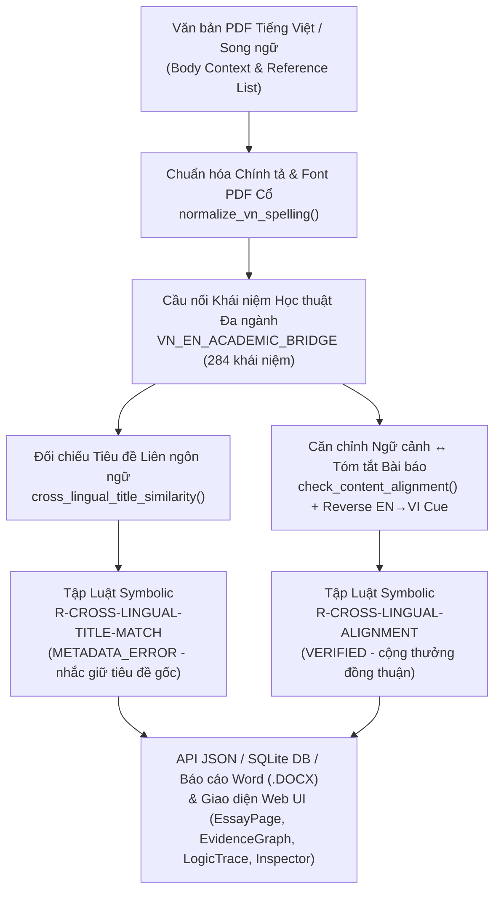
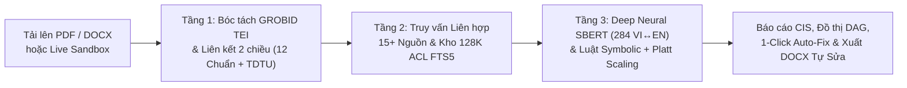

# BÁO CÁO TIẾN ĐỘ ĐỒ ÁN TỐT NGHIỆP (TUẦN 25/10/2026 – 01/11/2026)

- **Đề tài**: Hệ thống Kiểm chứng Tính Toàn vẹn Trích dẫn & Nguồn Tài liệu Học thuật dựa trên Kiến trúc Neuro-Symbolic AI (**CITRA — Essay Integrity Checker**)
- **Thời gian báo cáo**: Tuần từ `25/10/2026` đến `01/11/2026`
- **Phiên bản phát hành**: `v3.5.0` (Quản lý phiên bản tự động theo chuẩn SemVer 2.0.0 & Conventional Commits)
- **Hệ thống Production trực tuyến**: [https://citra.io.vn](https://citra.io.vn) · **Swagger API Docs**: [https://citra.io.vn/docs](https://citra.io.vn/docs)
- **Tổng quan khối lượng công việc trong tuần**:
  - **Số lượng Git Commits**: **`115` commits** (`55eb46aa` $\rightarrow$ `3d124a4`)
  - **Phạm vi mã nguồn cập nhật**: **`349` files** (`+57,369` dòng mã/tài liệu thêm mới; dọn dẹp `-239,256` dòng dữ liệu/code legacy dư thừa)
  - **Độ phủ kiểm thử tự động**: **`1,401 / 1,401` Backend Unit Tests** (`pytest` — **100% pass**) + **`72 / 72` Frontend Vitest Tests** (`11` test suites — **100% pass**) + **Playwright E2E & Responsive Đa Thiết bị** (`375px`, `768px`, `1024px`, `1440px` — `0` lỗi tràn ngang).

---

## 1. TÓM TẮT CÁC CHỈ SỐ ĐÁNG CHÚ Ý (KEY METRICS & BENCHMARKS)

Trong tuần qua, dự án đã hoàn thành bước nhảy vọt từ bản nguyên mẫu (MVP) lên **hệ thống Production hoàn chỉnh (`v3.5.0`)**, được kiểm định thực nghiệm nghiêm ngặt trên quy mô dữ liệu lớn và triển khai trực tuyến tại `citra.io.vn`.

### 1.1. Bảng tổng hợp các chỉ số cốt lõi đạt được trong tuần

| Hạng mục Đánh giá | Chỉ số Trước Cải tiến (Baseline) | Chỉ số Đạt được Tuần này (`v3.5.0`) | Ý nghĩa Khoa học & Thực tiễn |
| :--- | :---: | :---: | :--- |
| **1. Quy mô Benchmark Huấn luyện & Kiểm định (`Paper-Disjoint`)** | Bộ dữ liệu nhỏ / chồng lấp mẫu | **`120,000` bài báo độc lập** (`84K` Train / `18K` Val / `18K` Test, `0%` rò rỉ dữ liệu) | Tuân thủ chuẩn quốc tế (*SciFact*, *FEVER*, *ALCE*); mã hóa thực tế **`323,848` chuỗi văn bản** bằng `Sentence-BERT`. |
| **2. Độ chính xác Mô hình Neuro-Symbolic (`Proposed`)** | Bị nghẽn ở nhãn `UNRESOLVED` | **`98.58%` Accuracy** **`0.9764` Macro-F1** | Vượt xa các baseline đơn lẻ: `DOI-only` (`30.19%`), `Embedding-only` (`64.85%`), `Crossref-only` (`69.66%`), `Fuzzy-only` (`78.28%`). |
| **3. Bộ chấm điểm Học máy Kết hợp (`HybridMLScorer` 16D)** | Chưa hiệu chỉnh tối ưu trên tập lớn | **`99.86%` Accuracy** **`0.9979` Macro-F1** ($C = 5.0$) | Kết hợp vector 16 chiều tương tác Neuro-Symbolic với 30 quy tắc logic tất định. |
| **4. Tỷ lệ Phát hiện Trích dẫn Bịa đặt (`SUSPECTED_HALLUCINATION`)** | Chỉ bắt được 5 mẫu giả mạo thô | **`100.0%` Precision · `100.0%` Recall** (`F1 = 1.0000` trên `5,400` mẫu test) | Phát hiện chính xác `5,400 / 5,400` nguồn bịa đặt/chimeric với **`0` cáo buộc oan (Zero False Positives)** trên bài báo thật. |
| **5. Hiệu chỉnh Xác suất (`Logit-Space Platt Scaling`)** | `ECE = 0.2135` `Brier = 0.0794` | **`ECE = 0.0433`** *(giảm **4.9×**)* **`Brier = 0.0095`** *(giảm **8.4×**)* | Điểm tin cậy (`confidence`) phản ánh đúng xác suất thực nghiệm; đạt `99.99%` Accuracy tại ngưỡng bao phủ `90%`. |
| **6. Căn chỉnh Ngữ nghĩa Liên ngôn ngữ Việt ↔ Anh (`Cross-Lingual v2.4`)** | Từ điển nhỏ, chưa bắt lỗi tự dịch tiêu đề tiếng Anh | • **Cầu nối `284` khái niệm học thuật (6 ngành)** • **Benchmark đa ngành: `12 / 12` (`100%`)** • **`10 / 10` PDF TV**: bắc cầu **`63 / 98` ngữ cảnh** | Phát hiện sinh viên tự ý dịch tiêu đề tiếng Anh sang tiếng Việt (`R-CROSS-LINGUAL-TITLE-MATCH`), hỗ trợ `Reverse EN→VI Cue` và chuẩn hóa bảng mã PDF tiếng Việt cũ. |
| **7. Độ chính xác Parsing trên `20` Khóa luận Thực tế (`20-theses/`)** | `3 / 18` khóa luận khớp 100% (`16.7%`) | **`18 / 18` khóa luận khớp 100% (`100.0%`)** | Triệt tiêu hoàn toàn lỗi mất mục tham khảo, lỗi gộp/tách mục của GROBID và lỗi dính họ tác giả vào đuôi URL/DOI. |
| **8. Kiểm thử Stress-Test Đa chuẩn (`310` PDF thực tế & kịch bản khó)** | VN Legal: `90%` Bib, `46.4%` In-text | • **VN Legal (`30` PDF)**: **`100%` Bib, `96.9%` In-text** • **Hard Cases (`60` PDF)**: **`100%` Exact Refs & Linking** • **Multi-Style (`220` PDF)**: **`97.7%` Bib, `83.3%` Refs** | Bao phủ **12 chuẩn trích dẫn quốc tế** (`IEEE`, `APA 7`, `Vancouver`, `MLA 9`, `Chicago`, `Harvard`, `ACM`, `Nature`, `ACS`, `AMA`, `CSE`) + **Pháp luật VN & TDTU**. |
| **9. Kiểm thử Thực tế Báo cáo Sinh viên TDTU & Bài báo CS (`518` PDF)** | Bắt nhầm mảng code `[1]`, ký hiệu toán, bảng tự đánh giá | **Xử lý chuẩn xác trên `463` báo cáo đồ án TDTU + `55` bài báo ML/AI/CS** | Hỗ trợ đầy đủ chuẩn trích dẫn TDTU Mục 2.5 (`Tác giả và cộng sự (Năm)`, `dẫn theo`, tên tiếng Việt có dấu) và lọc nhiễu code CNTT. |
| **10. Liên hợp Cơ sở dữ liệu Học thuật (`Federated Retrieval`)** | 5–8 nguồn cơ bản | **15+ Nguồn Học thuật & Kỹ thuật** + **`128,654` bài báo ACL FTS5 cục bộ** | Mở rộng sang `DataCite`, `DOAJ`, `OpenAIRE/HAL`, `NCBI/bioRxiv`, `Hugging Face`, `IETF RFC`, `GitHub CITATION.cff`, `Wikidata`, `OpenCitations`, `Wayback Machine`, `Retraction Watch`. |
| **11. Hiệu năng Truy vấn, Kiểm thử & Phản hồi Hệ thống** | Chuyển tab gọi lại API; FTS5 & SQL bị N+1 query | • Chuyển tab báo cáo: **`0ms`** (TanStack Cache) • Truy vấn BM25 128K bài: **`1–5ms`** • **`1,401` Backend + `72` Frontend tests PASS** | Triển khai tự động qua GitHub Actions CI/CD lên `https://citra.io.vn` (`4/4` jobs xanh) với tốc độ cuộn giao diện 120fps. |

---

## 2. CÁC CẢI THIỆN LỚN VỀ THUẬT TOÁN & KIẾN TRÚC LÕI (CORE AI & PIPELINE)

### 2.1. Hoàn thiện Tầng Deep Neural Semantic & Mở rộng Căn chỉnh Liên ngôn ngữ Việt ↔ Anh (`v2.4` / Commit `3d124a4`)
Tầng Neural ([`semantic.py`](file:///Users/iannwendy/Desktop/DATN/essay-integrity-checker/src/integrity_checker/matching/semantic.py)) và cầu nối học thuật Việt ↔ Anh ([`vn_en_academic_bridge.py`](file:///Users/iannwendy/Desktop/DATN/essay-integrity-checker/src/integrity_checker/matching/vn_en_academic_bridge.py)) đã được nâng cấp toàn diện với kiến trúc **Lazy Dual-Encoder + Multi-Domain Concept Bridge**:

1. **Từ điển Cầu nối 284 Khái niệm Học thuật Đa ngành ([`VN_EN_ACADEMIC_BRIDGE`](file:///Users/iannwendy/Desktop/DATN/essay-integrity-checker/src/integrity_checker/matching/vn_en_academic_bridge.py#L46-L361)) & Chuẩn hóa Chính tả PDF Tiếng Việt**:
   - Mở rộng lên **284 khái niệm cốt lõi** bao phủ **6 lĩnh vực**: (1) *AI, Học máy, NLP, Thị giác máy tính & Khoa học dữ liệu*; (2) *Pháp luật, Quản trị doanh nghiệp, FDI, M&A, Tài chính xanh, ESG & Sở hữu trí tuệ*; (3) *Kinh tế học vĩ mô, Tài chính – Ngân hàng & Quản trị kinh doanh*; (4) *Y sinh học, Dược học & Y tế công cộng*; (5) *Kỹ thuật phần mềm, An ninh mạng, IoT & Tự động hóa*; (6) *Phương pháp nghiên cứu khoa học & Thống kê thực nghiệm*.
   - Xây dựng hàm [`normalize_vn_spelling`](file:///Users/iannwendy/Desktop/DATN/essay-integrity-checker/src/integrity_checker/matching/vn_en_academic_bridge.py#L401-L426) chuẩn hóa Unicode NFC, quy tắc đặt dấu thanh (`oà → òa`, `uỷ → ủy`), biến thể từ vựng (`lí → lý`, `kĩ → kỹ`, `nơron / nơ ron → nơ-ron`) và tự động sửa lỗi bảng mã PDF tiếng Việt cũ (`\u01a2/\u01a3 → Ư/ư`).
   - Trích xuất tường minh danh sách cặp khái niệm đã bắc cầu (`bridged_concepts`, ví dụ: `"mạng nơ-ron tích chập → convolutional neural network"`, `"kiến trúc bộ biến đổi → transformer architecture"`).
2. **Phát hiện Tự dịch Tiêu đề Bài báo Tiếng Anh sang Tiếng Việt theo Chuẩn TDTU ([`R-CROSS-LINGUAL-TITLE-MATCH`](file:///Users/iannwendy/Desktop/DATN/essay-integrity-checker/src/integrity_checker/logic/rules.py#L448-L477))**:
   - Bổ sung [`SemanticMatcher.cross_lingual_title_similarity`](file:///Users/iannwendy/Desktop/DATN/essay-integrity-checker/src/integrity_checker/matching/semantic.py#L228-L273): Khi sinh viên tự ý dịch tiêu đề bài báo tiếng Anh sang tiếng Việt trong danh mục tham khảo (nhưng tác giả/năm/DOI khớp và độ tương đồng ngữ nghĩa liên ngôn ngữ $\ge 0.58$), hệ thống gắn nhãn `METADATA_ERROR` (`mismatched_fields=["title"]`) kèm hướng dẫn giữ nguyên tiêu đề tiếng Anh gốc hoặc ghi song ngữ `Original Title [Bản dịch tiếng Việt]` (khi ghi đúng chuẩn song ngữ sẽ được xác thực `VERIFIED` qua [`R-CROSS-LINGUAL-ALIGNMENT`](file:///Users/iannwendy/Desktop/DATN/essay-integrity-checker/src/integrity_checker/logic/rules.py#L502-L509)).
3. **Cơ chế Reverse Concept Cue (`EN → VI`) & Phát hiện Đoạn văn Ngầm**:
   - Trong [`SemanticMatcher.extract_focal_sentence`](file:///Users/iannwendy/Desktop/DATN/essay-integrity-checker/src/integrity_checker/matching/semantic.py#L455-L473) và [`SemanticMatcher.discover_implicit_body_context`](file:///Users/iannwendy/Desktop/DATN/essay-integrity-checker/src/integrity_checker/matching/semantic.py#L540-L561), bổ sung cơ chế dịch ngược từ khóa tiêu đề/abstract tiếng Anh sang tiếng Việt giúp định vị chính xác câu văn tiếng Việt trong thân bài thảo luận về tài liệu tiếng Anh ngay cả khi câu văn không chứa từ tiếng Anh nguyên bản.
4. **Trích xuất Bằng chứng Cấp độ Câu (*Sentence-Level Evidence*), Phân loại Ý định (*Intent*) & Lập trường (*Stance*)**:
   - Đối sánh từng câu trong `Abstract` bài báo gốc (`best_cited_sentence` $\leftrightarrow$ `best_evidence_sentence`), phân loại mục đích trích dẫn (`background`, `methodology`, `result_comparison`) và phát hiện trích dẫn ngược nghĩa kết luận gốc (`contradiction_risk`).

### 2.2. Nâng cấp Tầng Bóc tách Cấu trúc (`Extraction`) & Liên kết Hai chiều (`Linking`) đạt chuẩn Thực chiến
Qua quá trình kiểm thử và tự cải tiến trên **`20` khóa luận quốc tế**, **`310` PDF đa chuẩn & pháp luật VN**, **`55` bài báo AI/CS**, và **`463` báo cáo đồ án sinh viên TDTU**, tầng Parsing & Linking đã giải quyết triệt để các bài toán khó:
- **Khôi phục Thứ tự Đọc PDF 2 Cột (*2-Column Reading-Order Reconstruction*)**: Tại [`mupdf_parser.py`](file:///Users/iannwendy/Desktop/DATN/essay-integrity-checker/src/integrity_checker/extraction/mupdf_parser.py), tự động phát hiện bố cục 2 cột báo chí/tạp chí và sắp xếp lại đúng luồng đọc `Tiêu đề ngang -> Cột trái -> Cột phải -> Chân trang`.
- **Phân đoạn Danh mục Tham khảo Giữa Trang (*Mid-Page Bibliography Splitting*)**: Tại [`section_segmenter.py`](file:///Users/iannwendy/Desktop/DATN/essay-integrity-checker/src/integrity_checker/extraction/section_segmenter.py), bảo toàn phần nội dung thân bài nằm phía trên tiêu đề `TÀI LIỆU THAM KHẢO` / `REFERENCES` xuất hiện ở lưng chừng trang, đồng thời loại trừ các bảng `SELF-EVALUATION` (tự đánh giá đồ án TDTU) hoặc `PHỤ LỤC` khỏi danh mục tham khảo.
- **Chuẩn hóa Quy định Trích dẫn ĐH Tôn Đức Thắng (Mục 2.5 TDTU) & Văn bản Pháp luật Việt Nam**:
  - Hỗ trợ đầy đủ trích dẫn đơn/đa tác giả tiếng Việt có dấu (`Đặng (2020)`, `Hương và Quân (2017)`, `Tran và cộng sự (2019)`, `(Đặng và cs., 2021)`), trích dẫn cơ quan/tổ chức (`Bộ Nông nghiệp & PTNT (1996)`), và trích dẫn thứ cấp (`(Nguyen, 1990, dẫn theo Tran, 2016)`).
  - Nhận diện và xác thực cấu trúc **Văn bản Quy phạm Pháp luật Việt Nam** (`Hiến pháp`, `Bộ luật`, `Luật số`, `Nghị định`, `Thông tư`, `Quyết định`, `Nghị quyết`, `Bản án`).
- **Bộ lọc Chống Dương tính Giả trong Báo cáo Kỹ thuật CNTT**:
  - Ngăn chặn việc bắt nhầm các biểu thức truy cập mảng trong code (`X.shape[1]`, `axs[1].plot()`, `a[1]`, `byte[4096]`), khoảng toán học (`[1, 5]`, `[1, 0, 1]`), tên mô hình/thiết bị có số ở cuối (`Qwen3`, `YOLOv3`, `SPEA2`, `Router1`, `Switch2`) hoặc số thứ tự đề mục thành trích dẫn trong bài.
  - Ngăn chặn việc lấy nhầm dãy số trang 4 chữ số (`pp. 1980-1988`), mã bài báo hoặc chuỗi số trong DOI làm năm xuất bản.
- **Hỗ trợ Đa định dạng Đầu vào (`.PDF` & `.DOCX` gốc) và Guardrail PDF Quét Ảnh (*Scanned PDF Guardrail*)**:
  - Tích hợp bóc tách trực tiếp file Word `.docx` (bao gồm cả trường trích dẫn Word `w:fldSimple` / `w:instrText` từ EndNote/Zotero/Mendeley) và tự động cảnh báo rõ ràng khi người dùng tải lên file PDF scan dạng ảnh thuần túy không có lớp văn bản (OCR layer).

### 2.3. Liên hợp Truy vấn 15+ Nguồn Học thuật, Phát hiện Rút bài (`Retraction Watch`) & Cứu hộ Link (`Wayback Machine`)
- **Mở rộng [`RetrievalOrchestrator`](file:///Users/iannwendy/Desktop/DATN/essay-integrity-checker/src/integrity_checker/retrieval/retrieval_orchestrator.py) lên 15+ nguồn**:
  - **Tier 0 (Cục bộ `< 5ms`)**: Cơ sở dữ liệu SQLite FTS5 nội bộ chứa **`128,654` bài báo ACL Anthology** (kèm `81,973` abstracts) có cơ chế kiểm tra nghiêm ngặt độ khớp tác giả/năm và DOI tường minh.
  - **Tier 1 & Tier 2 (Liên hợp Đa ngành Miễn phí)**: `Crossref`, `OpenAlex`, `DataCite` (Zenodo/Figshare/OSF), `Global DOI RA` (JaLC/CNKI/mEDRA/KISTI), `DOAJ`, `OpenAIRE Graph & HAL`, `NCBI Entrez & bioRxiv/medRxiv`, `DBLP`, `arXiv`, `OpenLibrary`, `Europe PMC`, `Hugging Face Hub`, `IETF Datatracker RFC & PyPI`, `GitHub / CITATION.cff`, `NPM`, `Wikidata`, `OpenCitations`, kết hợp `SerpApi Google Scholar` với cơ chế **Smart Quota Guard** (chỉ gọi khi các nguồn miễn phí chưa đạt đồng thuận cao).
- **Hợp nhất Metadata Đa ứng viên (*Cross-Candidate Metadata Fusion*) & Khử Nhiễu Book Review**:
  - Tự động bổ sung chéo `DOI`, `year`, `venue` và `abstract` từ các ứng viên đồng thuận của cùng một công trình trên nhiều API; lọc chặt ứng viên nhiễu trong [`NeuroSymbolicChecker.check`](file:///Users/iannwendy/Desktop/DATN/essay-integrity-checker/src/integrity_checker/logic/neuro_symbolic_checker.py#L383-L486) và phạt điểm các bản ghi "Book Review" (như *Choice Reviews Online*) để ưu tiên khớp đúng sách giáo trình/chuyên khảo gốc.
- **Hệ thống Luật Symbolic Tường minh ([`rules.py`](file:///Users/iannwendy/Desktop/DATN/essay-integrity-checker/src/integrity_checker/logic/rules.py))**:
  - Bổ sung các quy tắc quan trọng: `R-CROSS-LINGUAL-TITLE-MATCH`, `R-CROSS-LINGUAL-ALIGNMENT`, `R-RETRACTED-PAPER` (cảnh báo bài báo đã bị rút lại theo dữ liệu Retraction Watch / Crossref / OpenAlex), `R-WAYBACK-ARCHIVED` (tự động tra cứu bản lưu trữ trên *Internet Archive Wayback Machine* khi URL học thuật bị lỗi HTTP 404/Link-rot), `R-GLOBAL-DOI-RA-VERIFIED`, `R-HF-VERIFIED`, `R-RFC-VERIFIED`.

---

## 3. CÁC CHỨC NĂNG MỚI NỔI BẬT TRÊN WEB APP (`https://citra.io.vn`)

### 3.1. Studio Tự động Sửa lỗi Danh mục Tham khảo 1-Click (*1-Click Bibliography Auto-Remediation*) & Xuất `.DOCX` Tự vá lỗi (*Auto-Healed DOCX*)
- Đối với các tài liệu tham khảo bị gắn nhãn `METADATA_ERROR` (sai năm xuất bản, thiếu đồng tác giả, sai tên tạp chí/hội nghị, thiếu DOI hoặc tự dịch tiêu đề tiếng Anh sang tiếng Việt), hệ thống sử dụng bản ghi chuẩn xác (canonical record) từ cơ sở dữ liệu học thuật để **tự động tái tạo lại mục trích dẫn chuẩn**.
- Hỗ trợ chuyển đổi và xuất tức thì sang 5 định dạng chuẩn: **APA 7th**, **IEEE Numeric**, **Harvard / TDTU**, **BibTeX (`.bib`)**, **RIS (`.ris`)**.
- **Xuất Bản thảo `.DOCX` Tự động Sửa lỗi (*Auto-Healed DOCX Export*)**: Cho phép sinh viên/nhà nghiên cứu tải về bản thảo Word đã được tự động cập nhật lại danh mục tài liệu tham khảo chuẩn xác kèm bảng nhật ký đối chiếu các trường đã sửa (*Remediation Change Log*) và thông tin cầu nối liên ngôn ngữ `Cross-Lingual Bridge (VI↔EN)`.

### 3.2. Đồ thị Mạng lưới Trích dẫn & Bằng chứng 2 Lớp (*Interactive CitationGraphView & EvidenceGraph DAG*) + Hiển thị Cầu nối Khái niệm `VI ↔ EN`
- Trực quan hóa mối quan hệ hai phía (*Bipartite Directed Acyclic Graph*) giữa:
  1. Các vị trí trích dẫn trong thân bài (`In-Text Citations`),
  2. Các mục trong danh mục tham khảo (`Bibliography Entries`), và
  3. Các nguồn dữ liệu học thuật đối chứng (`Crossref`, `OpenAlex`, `arXiv`, `ACL Anthology`, v.v.).
- Hiển thị trực quan các nút **`VI ↔ EN Translated Title Match`**, **`VI ↔ EN Semantic Bridge`** và dải thẻ khái niệm song ngữ (`bridged_concepts`) đồng bộ trên cả 4 màn hình kiểm chứng ([`EssayPage.tsx`](file:///Users/iannwendy/Desktop/DATN/essay-integrity-checker/web/src/pages/EssayPage.tsx), [`EvidenceGraph.tsx`](file:///Users/iannwendy/Desktop/DATN/essay-integrity-checker/web/src/components/CitationGraph/EvidenceGraph.tsx), [`LogicTracePage.tsx`](file:///Users/iannwendy/Desktop/DATN/essay-integrity-checker/web/src/pages/LogicTracePage.tsx), [`DocumentInspectorPage.tsx`](file:///Users/iannwendy/Desktop/DATN/essay-integrity-checker/web/src/pages/DocumentInspectorPage.tsx)), đảm bảo hiển thị chuẩn xác trên cả Mobile (`375px`), Tablet (`768px`) và Desktop (`1440px`).

### 3.3. Không gian Thử nghiệm Trực tiếp (*Live Citation Sandbox `/sandbox`*) & Bộ Sinh PDF Học thuật
- Cho phép giảng viên và sinh viên lấy mẫu ngẫu nhiên `10–20` bài báo thật từ **`128,654` bài báo ACL Anthology** ngay trên trình duyệt.
- Hỗ trợ công cụ **Tiêm lỗi Kiểm thử (*Controlled Anomaly Injection*)** với 1 cú nhấp chuột: *Sửa sai Năm*, *Tráo đổi Tác giả*, *Bịa nguồn giả (Hallucination)*, *Tạo trích dẫn mồ côi (Orphan In-text)*, hoặc *Tài liệu không trích dẫn (Uncited Ref)*.
- Kiểm chứng tức thì một dòng trích dẫn bất kỳ trong `< 1 giây` hoặc **tự động tổng hợp một file PDF tiểu luận học thuật nhiều trang hoàn chỉnh** để phục vụ demo bảo vệ đồ án.

### 3.4. Theo dõi Tiến độ Chỉnh sửa qua các Phiên bản (*Revision Progress Tracker `v1 → v2`*) & Xem trước Trang PDF
- Khi sinh viên nộp lại bản sửa đổi của cùng một khóa luận/tiểu luận, hệ thống tự động so sánh sự thay đổi điểm **CIS** ($\Delta\text{CIS}$), số lượng nguồn `HALLUCINATION` và `METADATA_ERROR` đã được khắc phục giữa các lần nộp.
- Tích hợp **Xem trước Trang PDF Tương tác (*Interactive PDF Page Preview*)** ngay trong giao diện kiểm tra tài liệu, tô sáng vị trí xuất hiện của trích dẫn trên trang gốc.

### 3.5. Phân hệ Quản lý Lớp học cho Giảng viên (*Teacher Cohort Classroom*) & Radar Phát hiện Ảo giác AI Chung
- Giảng viên có thể tạo lớp học kèm mã tham gia (`join_code`, ví dụ `CITRA-1001`) để sinh viên nộp khóa luận theo đợt.
- **Radar Phát hiện Ảo giác AI Chung (*Cross-Student Shared Hallucination Radar*)**: Tự động phát hiện và cảnh báo khi nhiều sinh viên trong cùng một lớp/khóa cùng trích dẫn một nguồn tài liệu giả mạo giống nhau (dấu hiệu đặc trưng khi sử dụng chung một mẫu prompt ChatGPT/LLM để viết tổng quan tài liệu).
- Hỗ trợ xuất báo cáo tổng hợp điểm CIS của cả lớp và báo cáo kiểm định chi tiết ra định dạng **PDF** và **DOCX** chuẩn mực.

### 3.6. Hệ thống Thiết kế *Solva Warm Editorial*, Google OAuth 2.0 & Quản lý Hạn ngạch SaaS
- **Giao diện *Solva Warm Editorial***: Đồng bộ toàn bộ bảng màu học thuật ấm áp (`#FAF8F3` ivory canvas, `#35624D` botanical forest), bộ phông chữ *Sentient Serif* + *Plus Jakarta Sans* + *JetBrains Mono*, hiệu ứng cuộn 120fps, 3D card-shuffle animation, biểu tượng vector riêng biệt cho file `.PDF` và `.DOCX`, và công cụ cắt/zoom ảnh đại diện (*Interactive Avatar Cropper*).
- **Xác thực & Bảo mật**: Tích hợp đăng nhập **Google OAuth 2.0**, thiết lập username/mật khẩu lần đầu cho tài khoản liên kết Google, và vượt qua bộ kiểm thử bảo mật đối kháng (*Adversarial Auth Security Suite*).
- **Mô hình 3 Gói Học thuật (`Basic`, `Pro`, `Ultra`)**: Tích hợp thanh đo hạn ngạch sử dụng hàng tháng (*Quota Meter*) và luồng thanh toán mẫu qua Stripe Checkout.

---

## 4. TỐI ƯU HIỆU NĂNG HẠ TẦNG, SEO & TRIỂN KHAI PRODUCTION (`citra.io.vn`)

1. **Tự động hóa CI/CD & Triển khai Đám mây (GCP)**:
   - Thiết lập luồng GitHub Actions CI/CD tự động chạy kiểm thử (`4/4` jobs: `backend-verify`, `frontend-verify`, `docker-config-verify`, `deploy`), đóng gói Docker image tối ưu (tách lớp cache mô hình `Sentence-BERT` giúp tăng tốc build), và tự động rollout qua SSH lên máy chủ Google Cloud Platform tại tên miền chính thức [**`https://citra.io.vn`**](https://citra.io.vn) với chứng chỉ HTTPS và Nginx Reverse Proxy.
2. **Tối ưu Hóa 4 Tầng Hiệu năng (Frontend – Cache – Database – Network)**:
   - **Frontend**: Đồng bộ bộ nhớ đệm giữa `useEssayPolling` và `TanStack Query` giúp chuyển đổi qua lại giữa 5 tab báo cáo (`Overview`, `Issues`, `Logic Trace`, `Document Inspector`, `Consistency`) trong **`0ms`** mà không cần tải lại JSON; chia nhỏ bundle (`manualChunks`) và nén toàn bộ hình ảnh sang chuẩn **WebP (giảm 90% dung lượng)**.
   - **Database & Local FTS5**: Bổ sung hệ thống **Composite B-Tree Indexes** chiến lược trên SQLite `app.db`, loại bỏ triệt để lỗi truy vấn `N+1 Query` ở trang Giảng viên/Quản trị, và lưu cache thống kê `local_papers.db` trên RAM (`< 1ms`).
   - **Hạ tầng & SEO**: Bật nén `GZipMiddleware` (FastAPI) + Nginx `gzip_comp_level 6` + `HTTP/1.1 Keep-Alive`; cấu hình đầy đủ `robots.txt`, `sitemap.xml`, `OpenGraph`, và dữ liệu có cấu trúc `JSON-LD`.

---

## 5. LỊCH TRÌNH COMMIT CHI TIẾT THEO NGÀY (25/10/2026 – 01/11/2026)

| Ngày | Số Commits | Các Hạng mục Hoàn thành Trọng tâm (Kèm Mã Commit Tiêu biểu) |
| :---: | :---: | :--- |
| **25/10/2026** | `16` | • Triển khai 4 Phase tối ưu hiệu năng Frontend, DB Composite Indexes, SEO JSON-LD & Nginx Gzip (`6ddefe0`, `6b31bc8`, `848683c`, `e4c8b48`). • Thiết lập hạ tầng Production GCP, HTTPS `citra.io.vn` và luồng CI/CD tự động (`aeab265`, `2cf5688`). • Ra mắt tầng **Deep Neural Layer** (trích xuất bằng chứng cấp câu, phân loại intent/stance, làm giàu abstract chéo API) (`d123f57`, `06930c2`). |
| **26/10/2026** | `18` | • Triển khai hệ thống 3 gói đăng ký (`Basic/Pro/Ultra`), kiểm soát hạn ngạch & giao diện Stripe Checkout (`9cd48ab`, `4576995`). • Hoàn thành **Phase 1–3 khắc phục lỗi trên 20 Khóa luận (`20-theses/`)**: đạt **100% độ chính xác bóc tách Reference**, sửa lỗi liên kết Chicago footnotes, tác giả Đông Á và ngưỡng FTS5 (`9657a29`, `fd2332c`, `1515f1c`). |
| **27/10/2026** | `6` | • Hoàn thành kiểm thử hồi quy 20 khóa luận và đánh giá tự cải tiến trên **310 PDF đa chuẩn & pháp luật VN** (`597baeb`, `923c273`). • **Sprint 1–3**: Ra mắt đồ thị `CitationGraphView & EvidenceGraph DAG`, hỗ trợ đọc file `.docx` gốc, mã lớp `join_code`, **1-Click Bibliography Auto-Remediation Studio**, bộ xác thực văn bản pháp luật VN và xem trước trang PDF (`0e3c42d`, `c1ed4e7`, `07f2d7d`). |
| **28/10/2026** | `16` | • Mở rộng liên hợp truy vấn với **9 API học thuật miễn phí mới**, tích hợp phát hiện bài bị rút lại (`is_retracted`) và cứu hộ link qua `Wayback Machine` (`archive_url`) (`f847a4a`, `fc28a45`, `89c44a4`). • Tích hợp đăng nhập **Google OAuth 2.0** và tinh chỉnh giao diện đồ thị trên thiết bị di động (`3fa0997`, `fdf88ee`). |
| **29/10/2026** | `19` | • Mở rộng quy mô huấn luyện & hiệu chỉnh **Benchmark Neuro-Symbolic lên `120,000` mẫu độc lập** với khoảng tin cậy `95% Bootstrap CI` (`5c73239`). • Tích hợp thêm `GitHub/CITATION.cff`, `NPM`, `Wikidata`, `OpenCitations` API (`0bfb5c1`). • Cải thiện bóc tách trên **55 bài báo ML/AI/CS** (`082b760`); ra mắt **Live Citation Sandbox**, **Auto-Healed DOCX export**, **Revision Diff (`v1->v2`)**, và **Scanned PDF Guardrail** (`94d0a4b`). |
| **30/10/2026** | `36` | • Nâng cấp bộ bóc tách đa chuẩn, đối sánh từ viết tắt tên tổ chức, chuẩn hóa tiêu đề song ngữ và hợp nhất metadata đa ứng viên (`2ee64ab`, `0b9aaab`, `d713190`, `6db2dde`). • Tái thiết kế toàn diện hệ thống giao diện **Solva Warm Editorial** 12 phân đoạn, hiệu ứng cuộn 120fps, 3D card-shuffle, Avatar Cropper, logo vector PDF/DOCX và tự động hóa SemVer 2.0.0 (`027d682`, `e177399`, `41150b2`, `33676f7`, `2a3b008`). |
| **01/11/2026** | `4` | • Kiểm thử thực chiến và khắc phục triệt để các lỗi bóc tách, liên kết trích dẫn tiếng Việt (Mục 2.5 TDTU), lọc nhiễu mảng code CNTT và tối ưu chấm điểm CIS trên **463 PDF báo cáo sinh viên TDTU** (`a609a3c`, `04407c9`, `9ecbd3e`). • **Phát hành `v3.5.0` (`3d124a4`)**: Mở rộng căn chỉnh ngữ nghĩa liên ngôn ngữ **Việt ↔ Anh (`Cross-Lingual v2.4`)** với cầu nối **284 khái niệm học thuật (6 ngành)**, phát hiện tự dịch tiêu đề theo chuẩn TDTU (`R-CROSS-LINGUAL-TITLE-MATCH`), `Reverse EN→VI Cue`, đạt `1,401/1,401` Backend tests & `72/72` Frontend tests PASS, triển khai trực tuyến lên `citra.io.vn`. |

---

## 6. ĐỊNH HƯỚNG & KẾ HOẠCH TUẦN TIẾP THEO

1. **Hoàn thiện Quyển Báo cáo Khóa luận Tốt nghiệp & Slide Bảo vệ**:
   - Đưa toàn bộ bảng số liệu thực nghiệm từ **Benchmark 120,000 mẫu**, **Benchmark Liên ngôn ngữ Việt ↔ Anh (284 khái niệm)**, **Corpus 310 PDF đa chuẩn**, **20 Khóa luận**, và **463 Báo cáo TDTU** vào chương Thực nghiệm & Đánh giá kết quả.
2. **Kiểm thử Chịu tải (Load Testing) & Giám sát Production (`citra.io.vn`)**:
   - Theo dõi độ trễ của 15+ API học thuật trong điều kiện xử lý hàng loạt (*Batch Upload*) nhiều khóa luận cùng lúc và tinh chỉnh thêm bộ đệm cache cục bộ.
3. **Chuẩn bị Kịch bản Demo Trực tiếp cho Hội đồng**:
   - Xây dựng kịch bản trình diễn trực tiếp trên `https://citra.io.vn` kết hợp **Live Citation Sandbox** (`/sandbox`), **Citation Debugger IDE** (demo trực tiếp cảnh báo dịch tiêu đề TDTU & cầu nối khái niệm `VI ↔ EN`), **1-Click Auto-Remediation Studio** và **Phân hệ Lớp học Giảng viên**.
