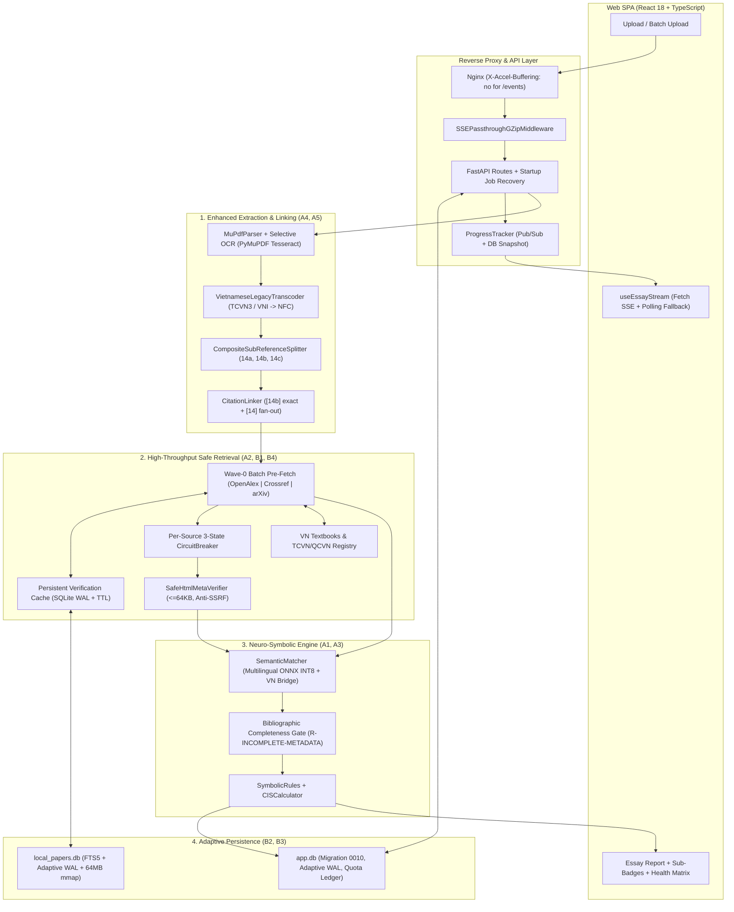
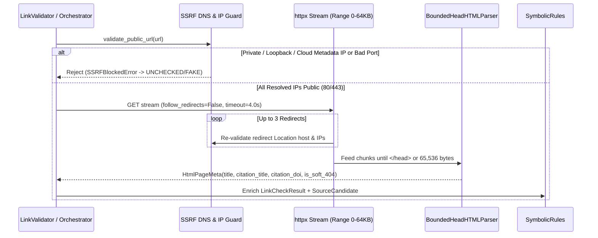
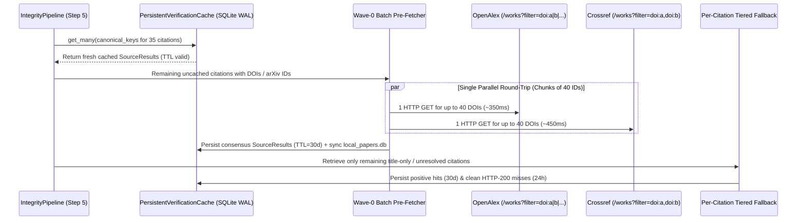
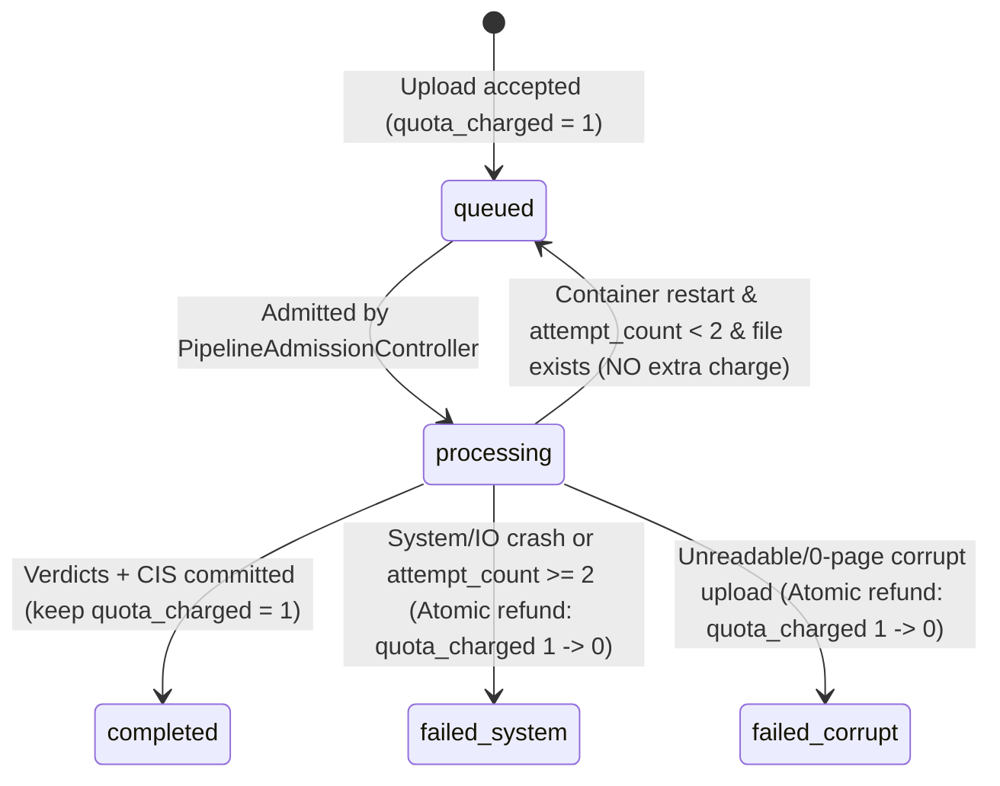
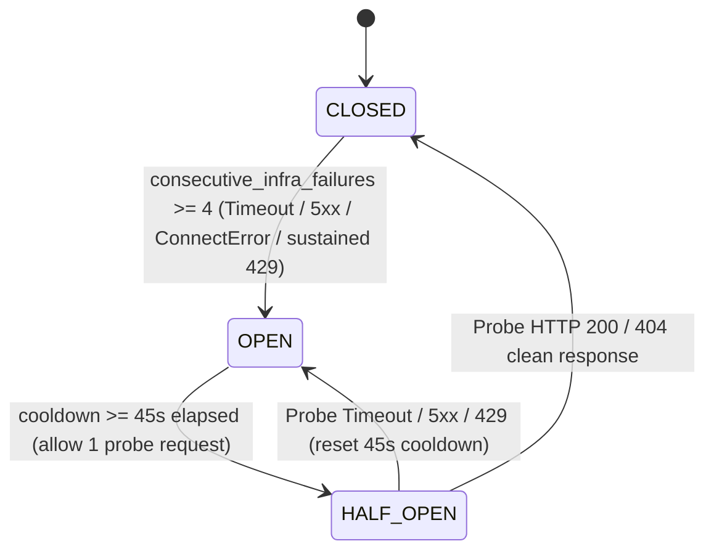

# Thiết Kế Kiến Trúc & Kế Hoạch Triển Khai Nâng Cấp Toàn Diện CITRA v3.61 (Accuracy + Operations)

> **For agentic workers:** REQUIRED SUB-SKILL: Use superpowers:subagent-driven-development (recommended) or superpowers:executing-plans to implement this plan task-by-task. Steps use checkbox (`- [ ]`) syntax for tracking.

**Goal:** Nâng cấp toàn diện độ chính xác kiểm chứng học thuật (5 phân hệ `A1–A5`) và năng lực vận hành, tốc độ xử lý, khả năng chịu tải sản xuất (4 phân hệ `B1–B4`) trên nền tảng CITRA `v3.60.3` mà không phá vỡ bất kỳ hợp đồng API, taxonomy 5 nhãn đề cương §5.2 hay bộ kiểm thử hồi quy hiện hữu (`1,799` Pytest + `247` Vitest + `159` Playwright).

**Architecture:** Thiết kế theo nguyên lý *Additive & Fail-Safe Layered Upgrade*: (1) Mở rộng tầng Retrieval bằng Wave-0 Batch DOI/arXiv Pre-fetch, Persistent Verification Cache có TTL, Per-Source 3-State Circuit Breaker và SSRF-Safe HTML `<head>` Verifier; (2) Nâng cấp tầng Extraction bằng bộ giải mã font tiếng Việt cổ (`TCVN3`/`VNI` → Unicode `NFC`), OCR chọn lọc theo trang dựa trên nhân C++ Tesseract tích hợp sẵn trong `PyMuPDF`, và bộ tách sub-reference `14a/14b/14c` cho ngành Hóa/Lý; (3) Tinh chỉnh tầng Neuro-Symbolic bằng cổng kiểm tra độ đầy đủ thư mục (`R-INCOMPLETE-METADATA` tách biệt khỏi `SUSPECTED_HALLUCINATION`) và mô hình ngôn ngữ đa ngữ lượng tử hóa `ONNX INT8` (`~118 MB`); (4) Củng cố tầng Hạ tầng bằng SQLite `WAL` thích ứng Linux/VirtioFS, khôi phục tác vụ mồ côi kèm sổ cái hoàn trả quota (`Migration 0010`), và luồng tiến độ thời gian thực `SSE` xuyên qua Nginx/GZip.

**Tech Stack:** Python 3.11+ / FastAPI / SQLAlchemy 2.0 / Alembic (`MigrationStep` SHA-256) / PyMuPDF 1.28 (`get_textpage_ocr` + `tessdata_fast`) / `sentence-transformers` (`backend="onnx"` INT8 qua `optimum[onnxruntime]`) / `httpx` Async / SQLite FTS5 & WAL / React 18 / TypeScript / TanStack Query / Nginx.

**Spec:** Tài liệu này đóng vai trò vừa là **Đặc tả Kiến trúc Chi tiết (Phần I & II)** vừa là **Kế hoạch Thực thi TDD Từng Bước (Phần III & IV)** dựa trên kết quả kiểm toán 1,064 PDF ([BAO_CAO_AUDIT_PARSING_LINKING_TOAN_DIEN_2026-11-13.md](file:///Users/iannwendy/Desktop/DATN/essay-integrity-checker/docs/BAO_CAO_AUDIT_PARSING_LINKING_TOAN_DIEN_2026-11-13.md)) và đợt kiểm thử toàn diện Priority 1–2–3 trên `v3.60.3`.

---

## Global Constraints

1. **Bảo toàn Taxonomy 5 Nhãn (§5.2):** Tuyệt đối giữ nguyên 5 giá trị `ValidationLabel` trong [validation.py](file:///Users/iannwendy/Desktop/DATN/essay-integrity-checker/src/integrity_checker/models/validation.py#L22-L33) (`verified`, `metadata_error`, `suspected_hallucination`, `unresolved`, `resource`). Mọi phân nhánh nghiệp vụ mới (như trích dẫn thiếu thông tin `R-INCOMPLETE-METADATA` hoặc lệch nội dung trang web `R-URL-CONTENT-MISMATCH`) biểu diễn qua `triggered_rules` + `mismatched_fields` + sub-badge UI, không thêm enum thứ 6 gây gãy tương thích ngược.
2. **Trần Bộ nhớ Container (`2560 MB`):** Dịch vụ `integrity-api` trong [docker-compose.prod.yml](file:///Users/iannwendy/Desktop/DATN/essay-integrity-checker/docker-compose.prod.yml#L82-L87) bị giới hạn cứng `2560M`. Tổng RSS lúc tải đỉnh (FastAPI + PyMuPDF + `all-MiniLM-L6-v2` + encoder đa ngữ `ONNX INT8` + 2 luồng pipeline đồng thời) bắt buộc giữ ở ngưỡng `<= 1,100 MB` (`< 45%` giới hạn).
3. **Chống SSRF & Đọc Mạng Có Trần (`Zero-Trust Outbound HTTP`):** Mọi kết nối tải HTML từ URL trong bài nộp sinh viên phải phân giải DNS trước mỗi hop redirect (`max_redirects=3`), chặn toàn bộ dải IP nội bộ/loopback/link-local/cloud-metadata (`127.0.0.0/8`, `10.0.0.0/8`, `172.16.0.0/12`, `192.168.0.0/16`, `169.254.0.0/16`, `100.64.0.0/10`, `::1`, `fc00::/7`, `fe80::/10`), chỉ cho phép port `80/443`, `timeout <= 4.0s`, và đọc tối đa `65,536 bytes` (`64 KB`).
4. **An toàn Cơ sở Dữ liệu & Tương thích Đa nền tảng:** Mọi thay đổi schema trên `app.db` phải đi qua hệ thống migration có kiểm tra SHA-256 trong [migrations.py](file:///Users/iannwendy/Desktop/DATN/essay-integrity-checker/src/integrity_checker/db/migrations.py) (`version="0010"`), hỗ trợ `upgrade` + `downgrade` sạch, và không bao giờ chạm tới `data/app.db` thật khi chạy `pytest` (`is_test_runtime()`).
5. **Khả năng Chạy Độc lập Không Phụ thuộc Gói Tùy chọn (Graceful Degradation):** Nếu môi trường chạy thiếu `onnxruntime` hoặc thiếu `tessdata` (`vie.traineddata`/`eng.traineddata`), hệ thống tự động fallback êm về PyTorch/dictionary bridge và cảnh báo `SCANNED_PDF_DETECTED` hiện hữu — không bao giờ crash lúc import hoặc khởi động.

## Review Focus

Năm tình huống biên thực tế dễ gây lỗi ngầm nhất nếu không có test ghim chặt ngay trong từng Task:

1. **Nhận diện nhầm chữ Âu có dấu (`Müller, François, Sørensen, Kühn`) thành mã `TCVN3` / `VNI-Windows`:** Các ký tự Latin mở rộng (`0xA1–0xFE`) trùng vùng mã với bảng mã 1-byte `TCVN3`. Bộ giải mã `VietnameseLegacyTranscoder` (Task 5) bắt buộc kiểm tra đồng thời hình vị âm tiết tiếng Việt + độ tăng tỷ lệ âm tiết hợp lệ (`delta >= +0.45`) và từ chối chuyển mã nếu chuỗi chỉ chứa tên riêng châu Âu.
2. **Đứt luồng SSE do `GZipMiddleware` và Nginx `proxy_buffering`:** Trong [main.py](file:///Users/iannwendy/Desktop/DATN/essay-integrity-checker/src/integrity_checker/api/main.py#L76), `GZipMiddleware(minimum_size=1000)` của Starlette gom đệm các chunk `StreamingResponse`, làm trình duyệt không nhận được sự kiện từng bước cho tới khi đóng luồng. Task 9 phải bọc bypass `GZipMiddleware` cho `text/event-stream` và trả header `X-Accel-Buffering: no`.
3. **Tính trùng hoặc hoàn trả kép hạn ngạch (`Double Quota Refund / Double Charge`) khi container restart nhiều lần:** Nếu một bài đang xử lý bị restart 2 lần liên tiếp rồi cuối cùng thất bại, cơ chế hoàn trả `monthly_uploads_used` (Task 3) phải cập nhật nguyên tử `UPDATE essays SET quota_charged = 0 WHERE id = :id AND quota_charged = 1` trong cùng transaction với `UPDATE users SET monthly_uploads_used = MAX(0, monthly_uploads_used - 1)` để đảm bảo **chính xác 1 lần hoàn trả duy nhất**.
4. **Tách nhầm tên đồng phân hóa học trong tiêu đề (`(a)-isomer and (b)-enantiomer`) thành sub-reference `14a, 14b`:** Bộ tách `CompositeSubReferenceSplitter` (Task 6) chỉ được tách khi mỗi phân đoạn `(a)`, `(b)` mang dấu hiệu thư mục độc lập (có năm xuất bản `(19|20)\d{2}` hoặc DOI hoặc mẫu tạp chí + số trang riêng).
5. **Lưu nhầm lỗi mạng tạm thời (`HTTP 429 / 503 / Timeout`) vào Persistent Negative Cache 24h:** Nếu Crossref/OpenAlex trả `429` hoặc `CircuitBreaker` đang `OPEN`, kết quả trống đó tuyệt đối **không** được ghi vào cache âm tính dài hạn (Task 2 & Task 4); chỉ ghi khi `>= 3` nguồn học thuật trả `HTTP 200` sạch và `0` nguồn bị lỗi hạ tầng/circuit-open.

---

## Phần I: Tổng Quan Kiến Trúc Đích & Chỉ Tiêu Định Lượng (SLAs)

### 1.1. Bảng Chỉ Tiêu Nâng Cấp (`v3.60.3` → `v3.61.0`)

| Nhóm chỉ số | Hiện trạng (`v3.60.3`) | Mục tiêu (`v3.61.0`) | Phân hệ giải quyết |
| :--- | :--- | :--- | :--- |
| **Độ trễ khóa luận 35–40 trích dẫn (Cold cache)** | `41.0s – 56.8s` | **`8.0s – 13.5s`** (`-75%`) | `B1` (Batch DOI/arXiv) + `B4` (Circuit Breaker) |
| **Độ trễ nộp bài theo lớp 30–60 SV (Warm cache)** | `35.0s – 50.0s` (dễ dính `429`) | **`2.0s – 4.5s`** (`-90%`, `0` lỗi `429`) | `B1` (Persistent TTL Cache + Singleflight) |
| **Báo động giả `suspected_hallucination` trên trích dẫn cụt** | Bị gắn đỏ `R-HALLUCINATED-SOURCE` (vd `061_tdtu`) | **`0%`** (chuyển sang vàng `METADATA_ERROR` + `R-INCOMPLETE-METADATA`) | `A1` (Bibliographic Completeness Gate) |
| **Kiểm chứng ngữ nghĩa URL sống & phát hiện Soft-404 / URL mồi** | Chỉ kiểm mã HTTP `200..399` → gắn `RESOURCE` | Đối chiếu `<title>`/`citation_*` (`<= 64KB`, chống SSRF) | `A2` (Safe HTML Meta Verifier + VN Registry) |
| **Đối sánh nội dung xuyên ngôn ngữ Việt ↔ Anh (`Content Alignment`)** | Chỉ dựa trên từ điển 320 cụm từ + model đơn ngữ Anh | Dense Multilingual `ONNX INT8` (`50+` ngôn ngữ, mọi chuyên ngành) | `A3` (Quantized Multilingual Encoder) |
| **Tài liệu PDF quét ảnh một phần / Font `TCVN3`, `VNI-Windows`** | Mất mục Tài liệu tham khảo / lỗi font ký tự lạ | Tự khôi phục Unicode `NFC` + OCR chọn lọc `<= 15` trang trọng yếu | `A4` (Legacy VN Transcoder + PyMuPDF OCR) |
| **Trích dẫn gộp ngành Hóa/Lý (`14a, 14b, 14c`)** | Gộp chung thành 1 mục `[14]` gây xung đột DOI | Tách độc lập `14a, 14b, 14c`, nối đúng cả `[14]` lẫn `[14b]` | `A5` (Composite Sub-Reference Splitter) |
| **Độ bền tác vụ nền & hạn ngạch khi restart container** | Mất trạng thái trong RAM, hụt 1 lượt upload của SV | **`100%`** tự chạy tiếp hoặc hoàn trả quota nguyên tử | `B2` (Migration `0010` + Startup Recovery) |
| **Chịu tải đọc/ghi SQLite trên máy chủ Linux** | `journal_mode=DELETE` khóa độc quyền khi ghi | Tự bật `WAL` + `mmap 64MB` trên Linux (giữ `DELETE` trên VirtioFS) | `B3` (Adaptive SQLite Tuning) |
| **Cập nhật tiến độ xử lý thời gian thực cho UI** | Polling mỗi `2s` (`20–40 req/s` khi nộp theo lô) | Đẩy tức thì qua `SSE` (`< 50ms`) + tự lùi về Polling khi cần | `B4` (`GET /essays/{id}/events` + Nginx unbuffered) |

### 1.2. Sơ đồ Kiến trúc Tổng thể CITRA `v3.61`



---

## Phần II: Thiết Kế Kỹ Thuật Chi Tiết Cho 9 Phân Hệ (`A1–A5` & `B1–B4`)

### 2.1. Phân hệ `A1` — Phân tách `R-INCOMPLETE-METADATA` khỏi `SUSPECTED_HALLUCINATION`

- **Hiện trạng & Nguyên nhân gốc trong `v3.60.3`:**
  1. Trong [rules.py](file:///Users/iannwendy/Desktop/DATN/essay-integrity-checker/src/integrity_checker/logic/rules.py#L135-L148), hàm `_has_substantive_citation_metadata()` trả `True` ngay khi `bool(citation_authors)` khác rỗng — kể cả khi GROBID hoặc regex cắt nhầm từ đầu tiên của một tiêu đề cụt (ví dụ `[2] Making a robot vacuum cleaner to avoid falling down the stairs` trong `061_tdtu` bị tách thành `authors=["Making"]`, `year=None`, `doi=None`, `url=None`, `venue=None`).
  2. Nguy hiểm hơn, tại nhánh cuối [rules.py](file:///Users/iannwendy/Desktop/DATN/essay-integrity-checker/src/integrity_checker/logic/rules.py#L2143-L2210), khi OpenAlex/Crossref trả về 1 bài báo ngẫu nhiên có `title_sim < 0.40`, hàm `evaluate()` thậm chí **không kiểm tra `has_substantive_meta`** mà gắn thẳng `ValidationLabel.SUSPECTED_HALLUCINATION` (`R-HALLUCINATED-SOURCE`)!
- **Thiết kế thuật toán `assess_bibliographic_completeness`:**
  - Định nghĩa `BibliographicCompleteness` trong `src/integrity_checker/logic/completeness.py`:
    - `has_resolvable_id`: `bool(doi or arxiv_id or isbn or pmid or (url and not is_fake_url))`
    - `has_valid_year`: `year` khớp `(18|19|20)\d{2}`
    - `has_real_authors`: danh sách `authors` sau khi loại trừ các token giả-tác-giả đầu câu (`{"making", "building", "designing", "using", "understanding", "introduction", "overview", "guide", "tutorial", "chapter", "hướng", "tìm", "nghiên", "xây", "thiết", "ứng", "giới", "tổng", "báo", "tài"}`) còn ít nhất 1 họ người hoặc tổ chức hợp lệ (`_INSTITUTIONAL_AUTHOR_RE`).
    - `has_academic_venue`: `bool(venue)` hoặc `raw_text` khớp `_PERIODICAL_JOURNAL_SIGNAL_RE` / `_BOOK_PUBLISHER_SIGNAL_RE`.
  - **Quy tắc Phân loại:**
    - Một mục tham khảo được đánh dấu **`is_incomplete = True`** khi: `not has_resolvable_id` **VÀ** `(not has_valid_year)` **VÀ** `(not has_academic_venue)` (hoặc chỉ có tiêu đề trần `not has_real_authors and not has_valid_year and not has_resolvable_id`).
    - Khi `is_incomplete == True` và không tìm thấy ứng viên khớp cao (`title_sim_max < 0.78`):
      - Trả về `ValidationLabel.METADATA_ERROR`, `confidence = 0.80`, `triggered_rules = ["R-INCOMPLETE-METADATA"]`, `mismatched_fields = [f for f in ("authors", "year", "venue") if missing]`.
    - Khi mục tham khảo **có** tuyên bố học thuật cụ thể (`has_valid_year` + `has_real_authors` + tên tạp chí/hội nghị, hoặc có `DOI` không tồn tại / URL giả / râu ông nọ cắm cằm bà kia) mà các CSDL trả 0 kết quả: **giữ nguyên `ValidationLabel.SUSPECTED_HALLUCINATION`** (`100%` độ nhạy phát hiện AI bịa đặt).
  - **Tác động lên CIS ([cis.py](file:///Users/iannwendy/Desktop/DATN/essay-integrity-checker/src/integrity_checker/logic/cis.py#L190-L260)) & UI:**
    - Trong `CISCalculator._compute_components`: verdict mang `R-INCOMPLETE-METADATA` nhận trọng số `0.25` ở `metadata_accuracy` (thấp hơn lỗi lệch 1 năm `0.50`, nhưng cao hơn `0.00` của `SUSPECTED_HALLUCINATION`).
    - Trên UI ([VerdictBadge.tsx](file:///Users/iannwendy/Desktop/DATN/essay-integrity-checker/web/src/components/VerdictBadge.tsx) & [verdictExplanation.ts](file:///Users/iannwendy/Desktop/DATN/essay-integrity-checker/web/src/lib/verdictExplanation.ts)): hiển thị nhãn phụ rõ ràng *"Thiếu quy cách trích dẫn / Incomplete Reference"* để giảng viên phân biệt ngay lỗi trình bày của sinh viên với gian lận AI.

---

### 2.2. Phân hệ `A2` — `SafeHtmlMetaVerifier` (Chống SSRF) & Mở rộng Danh mục `TCVN/QCVN` + Giáo trình Đại học VN

- **Thiết kế `SafeHtmlMetaVerifier` (`src/integrity_checker/retrieval/html_meta_verifier.py`):**



  - **Cấu trúc `HtmlPageMeta`:**
    - `page_title: str | None` (`<title>` hoặc `og:title`)
    - `citation_title: str | None` (`meta[name="citation_title"]` / `dc.title`)
    - `citation_authors: list[str]` (`meta[name="citation_author"]` / `meta[name="author"]`)
    - `citation_doi: str | None` (`meta[name="citation_doi"]`)
    - `published_year: str | None` (`citation_publication_date` / `article:published_time`)
    - `is_soft_404: bool` (khớp mẫu `^(?:404\b|page\s+not\s+found|không\s+tìm\s+thấy\s+trang|error\s+404|404\s+not\s+found)` kết hợp độ dài nội dung ngắn, loại trừ các bài viết kỹ thuật nói *về* lỗi HTTP 404).
  - **Logic Nâng cấp Phán quyết trong `SymbolicRules`:**
    1. Nếu `is_soft_404 == True` → chuyển `url_status` sang `dead_link` (thử Wayback fallback trước khi kết luận `R-DEAD-URL`).
    2. Nếu trang có `citation_doi` hợp lệ → kích hoạt đối chiếu chéo DOI học thuật để nâng từ `RESOURCE` lên `VERIFIED`!
    3. Nếu trích dẫn nêu tiêu đề cụ thể (`len(citation.title) >= 20`, không phải URL trần) và `page_title` thu được rõ ràng (không phải trang cổng đăng nhập chung như `"Sign in"`, `"Just a moment..."`, `"Cloudflare"`, `"Access Denied"`):
       - Tính `meta_sim = max(title_similarity(citation.title, page_title), semantic_sim)`.
       - Nếu `meta_sim < 0.20` (ví dụ bài viết trích dẫn *"Điều khiển PID cho cánh tay robot"* nhưng dán link báo giá vàng / repo không liên quan) → gắn `ValidationLabel.METADATA_ERROR` với `triggered_rules=["R-URL-CONTENT-MISMATCH"]`, `mismatched_fields=["url", "title"]`.
- **Mở rộng Kho Chuẩn Việt Nam (`data/registries/vn_standards_and_textbooks.json`):**
  - Bổ sung bộ nhận diện chính quy cho **Tiêu chuẩn / Quy chuẩn Kỹ thuật Quốc gia**:
    - `TCVN \d{4,5}(?:-\d+)?\s*:\s*(?:19|20)\d{2}` (vd: `TCVN 5574:2018`, `TCVN 9386-1:2012`)
    - `QCVN \d{1,3}(?:-\d+)?\s*:\s*(?:19|20)\d{2}\s*/\s*B[A-ZĐ]+` (vd: `QCVN 06:2022/BXD`, `QCVN 01-1:2018/BYT`, `QCVN 41:2019/BGTVT`)
  - Seed danh mục chuẩn hóa các giáo trình đại học nền tảng tại Việt Nam (NXB Giáo dục, NXB ĐHQG TP.HCM, NXB ĐHQG Hà Nội, NXB Bách Khoa, NXB Thống kê, NXB Chính trị Quốc gia Sự thật) vào `TechStandardClient` / `LocalDatabase` để trả kết quả tức thì không tốn API ngoài.

---

### 2.3. Phân hệ `A3` — `Cross-Lingual Content Alignment` với Multilingual `ONNX INT8`

- **Hiện trạng & Điểm nghẽn:**
  - [semantic.py](file:///Users/iannwendy/Desktop/DATN/essay-integrity-checker/src/integrity_checker/matching/semantic.py#L168-L180) đã có thuộc tính `multilingual_model_name = "sentence-transformers/paraphrase-multilingual-MiniLM-L12-v2"` và `enable_multilingual_encoder`, nhưng đang tắt (`False`) vì bản PyTorch FP32 nặng `~471 MB`.
- **Thiết kế Lượng tử hóa `ONNX INT8` (Xác thực theo tài liệu `sentence-transformers` v3/v5):**
  - Bổ sung tùy chọn `matching.onnx_quantized: bool = True` trong `MatchingConfig` ([config.py](file:///Users/iannwendy/Desktop/DATN/essay-integrity-checker/src/integrity_checker/config.py)).
  - Hàm `_load_multilingual_encoder()` trong [semantic.py](file:///Users/iannwendy/Desktop/DATN/essay-integrity-checker/src/integrity_checker/matching/semantic.py):
    1. Phát hiện tập lệnh CPU qua `platform.machine().lower()`:
       - `arm64` / `aarch64` → ưu tiên nạp `backend="onnx"`, `model_kwargs={"file_name": "onnx/model_qint8_arm64.onnx"}` (`~118 MB`).
       - `x86_64` / `amd64` → ưu tiên nạp `backend="onnx"`, `model_kwargs={"file_name": "onnx/model_qint8_avx2.onnx"}` (`~118 MB`, tương thích mọi CPU x86_64 máy chủ đám mây).
    2. Nếu môi trường chưa cài `optimum[onnxruntime]` hoặc chưa tải tệp ONNX cục bộ → tự động fallback êm sang PyTorch (`local_files_only=True` trước) → nếu vẫn không có thì fallback sang `all-MiniLM-L6-v2` + `VN_EN_ACADEMIC_BRIDGE`.
  - **Chiến lược Hợp nhất Điểm (`Hybrid Cross-Lingual Fusion`):**
    - Khi phát hiện cặp câu khác ngôn ngữ (`is_vietnamese_text(focal_sentence) != is_vietnamese_text(evidence_text)`):
      - Tính `sim_dense_multi` trực tiếp trên cặp câu gốc Việt ↔ Anh bằng encoder đa ngữ `ONNX INT8` (hiểu ngữ nghĩa câu hoàn chỉnh ở mọi ngành Y dược, Xây dựng, Hóa sinh, Kinh tế lượng mà không bị giới hạn bởi từ điển tĩnh).
      - Vẫn chạy `compute_cross_lingual_concept_overlap` từ [vn_en_academic_bridge.py](file:///Users/iannwendy/Desktop/DATN/essay-integrity-checker/src/integrity_checker/matching/vn_en_academic_bridge.py) để trích xuất danh sách `bridged_concepts` minh bạch cho giảng viên và lấy `max(sim_dense_multi, sim_bridged_en)`!
  - **Ngân sách RAM trong Docker (`Dockerfile`):**
    - Cài `onnxruntime>=1.18,<2.0` + `optimum[onnxruntime]>=1.20,<2.0` (chỉ tăng ~35 MB wheel CPU) và bake sẵn tệp quantized `onnx/model_qint8_*.onnx` của `paraphrase-multilingual-MiniLM-L12-v2` trong bước build Docker. Tổng RSS toàn tiến trình API giữ ở **`~760 MB / 2560 MB`**.

---

### 2.4. Phân hệ `A4` — Bộ Giải mã `TCVN3 / VNI-Windows → Unicode NFC` & OCR Chọn lọc Trang (`PyMuPDF` Native Tesseract)

- **1. Bộ Giải mã Bảng mã Tiếng Việt Cổ (`src/integrity_checker/extraction/vn_encoding.py`):**
  - Xây dựng bảng ánh xạ chuẩn 100% cho 2 bảng mã di sản phổ biến nhất ở Việt Nam:
    - **`VNI-Windows` (2-byte composite):** Nguyên âm gốc + dấu phụ đứng sau (`AØ`→`À`, `AÙ`→`Á`, `AÛ`→`Ả`, `AÕ`→`Ã`, `AÏ`→`Ạ`, `AÂ`→`Â`, `AÊ`→`Ă`, `OÂ`→`Ô`, `Ô`→`Ơ`, `Ö`→`Ư`, `Ñ`→`Đ`, cùng toàn bộ tổ hợp 2 tầng như `AÁ`→`Ấ`, `AẦ`→`Ầ`, `ÔÙ`→`Ớ`, `ÖÏ`→`Ự`...).
    - **`TCVN3 / ABC` (1-byte `.VnTime`):** Ánh xạ chính xác các byte `0xA1–0xFE` sang nguyên âm tiếng Việt có dấu + chữ hoa thông qua ngữ cảnh viết hoa (`Tµi liÖu tham kh¶o` → `Tài liệu tham khảo`, `§¹i häc B¸ch Khoa` → `Đại học Bách Khoa`).
  - ** Thuật toán Chống Chuyển mã Nhầm (`Phonotactic Safety Gate`):**
    - Tách văn bản theo dòng/khối (`block`). Không bao giờ áp dụng toàn cục nếu PDF có nhiều font trộn lẫn.
    - Một khối chỉ được chuyển mã khi:
      1. Chưa chứa các ký tự Unicode tiếng Việt tổ hợp sẵn (`ă, â, ê, ô, ơ, ư, ắ, ấ, ế, ố, ớ, ứ, ệ, ộ, ợ, ự`).
      2. Số lượng từ khớp cấu trúc âm tiết tiếng Việt chuẩn (`_VN_VALID_SYLLABLE_RE`: phụ âm đầu tiếng Việt + vần tiếng Việt hợp lệ) tăng thêm tối thiểu **`>= 3` từ** VÀ tỷ lệ âm tiết tiếng Việt hợp lệ tăng ít nhất **`+0.45`** sau khi giải mã (bảo vệ tuyệt đối các đoạn tiếng Pháp, Đức, Bắc Âu như `"François Müller, Søren Kierkegaard"`!).
      3. Nếu `MuPdfParser` đọc thấy tên font trên trang có tiền tố `.Vn` (`TCVN3`) hoặc `VNI-` (`VNI-Windows`), truyền cờ gợi ý `font_encoding_hint` xuống bộ giải mã.
- **2. OCR Chọn lọc Trang Không Phình Container (`MuPdfParser` + `get_textpage_ocr`):**
  - Khai thác trực tiếp nhân C++ Tesseract đã biên dịch sẵn trong `PyMuPDF 1.28` (`fitz.Page.get_textpage_ocr(language="vie+eng", dpi=200, full=True, tessdata=tessdata_dir)`):
    - Chỉ cần gói dữ liệu ngôn ngữ `tesseract-ocr-eng` + `tesseract-ocr-vie` (`~5.6 MB`) trong `Dockerfile` (hoặc thư mục `TESSDATA_PREFIX`), không cần cài thêm framework Deep Learning OCR nặng hàng trăm MB.
    - **Chiến lược chọn trang thông minh (`Page-Selective Budget`):**
      - Điều kiện kích hoạt trên trang `p`: `len(stripped_text) < 45` VÀ trang chứa ảnh raster diện tích `>= 25%` khổ trang.
      - Ngân sách cứng mỗi tài liệu: tối đa `MAX_OCR_PAGES = 15` trang và tổng thời gian OCR `<= 12.0s`.
      - Thứ tự ưu tiên khi số trang scan `> 15`: quét **10 trang cuối cùng** trước (nơi chứa *References / Tài liệu tham khảo*), sau đó tới **5 trang đầu tiên** (trang bìa, tóm tắt, mở đầu).
      - Cập nhật `metadata["ocr_pages_recovered"]` và chỉ giữ cảnh báo `SCANNED_PDF_DETECTED` ở mức thông tin nếu sau OCR vẫn thiếu text ở phần thân giữa.

---

### 2.5. Phân hệ `A5` — Xử lý Trích dẫn Gộp Đa phần Ngành Hóa / Vật lý (`Composite Sub-References: 14a, 14b, 14c`)

- **Thiết kế Mô hình Dữ liệu & Bộ Tách:**
  1. **Mở rộng `Citation` ([citation.py](file:///Users/iannwendy/Desktop/DATN/essay-integrity-checker/src/integrity_checker/models/citation.py#L85-L92)):**
     - Thêm `sub_index: str | None = None` (`"a"`, `"b"`, `"c"`) và `composite_label: str | None = None` (`"14a"`, `"14b"`, `"14c"`), giữ `numeric_index: int | None = 14` để tương thích ngược 100%.
  2. **Bộ tách `expand_composite_reference(citation: Citation) -> list[Citation]` (`src/integrity_checker/extraction/composite_splitter.py`):**
     - Nhận diện các mục `REFERENCE_LIST` có `numeric_index = N` chứa chuỗi đánh dấu con tuần tự `(a) ... (b) ...` (hoặc `a) ...; b) ...`).
     - **Điều kiện an toàn chống tách nhầm tiêu đề hóa học:**
       - Phải bắt đầu bằng `(a)` ngay đầu nội dung mục (sau số thứ tự `14.` hoặc `[14]`) hoặc ngay sau cụm dẫn ngắn, và các nhãn phải tăng liên tiếp theo bảng chữ cái (`a` → `b` → `c`...).
       - Ít nhất **2** phân đoạn con phải chứa dấu hiệu thư mục độc lập (năm `(19|20)\d{2}` hoặc `10.\d{4,9}/...` hoặc mẫu `Vol./ trang \d+[-–]\d+`).
     - Mỗi phân đoạn con được parse lại qua `ReferenceListParser.parse_single_entry()` để trích riêng `authors`, `year`, `title`, `venue`, `doi` và gắn `numeric_index=N`, `sub_index="a"`, `composite_label=f"{N}a"`.
  3. **Liên kết Hai chiều trong [citation_linker.py](file:///Users/iannwendy/Desktop/DATN/essay-integrity-checker/src/integrity_checker/linking/citation_linker.py):**
     - Mở rộng `_IEEE_NUM_RE` và bộ tách numeric sang nhận diện cả hậu tố chữ cái: `[14b]`, `[14a, 14c]`, `[14a–c]`, `(14b)`.
     - Lập chỉ mục kép: `bib_by_composite_label["14b"] -> ref_14b` và `bib_by_index[14] -> [ref_14a, ref_14b, ref_14c]`.
     - Khi trong bài viết gọi `[14b]` → nối chính xác 1-1 tới `ref_14b` (`MappingMethod.NUMERIC_INDEX`, `status=MATCHED`).
     - Khi trong bài viết gọi `[14]` (trích dẫn cả cụm) → tạo các cạnh `CitationLink` trong `citation_links` nối tới tất cả `ref_14a, ref_14b, ref_14c` với `status=MATCHED` (không bị gán nhầm `AMBIGUOUS_MAPPING` hay bỏ sót `UNCITED_REFERENCE` cho `14b, 14c`!).

---

### 2.6. Phân hệ `B1` — `Wave-0 Batch Identifier Pre-Fetch` & `Persistent Cross-Essay Verification Cache`



- **1. `Wave-0 Batch Pre-Fetch` trong `OpenAlexClient`, `CrossrefClient`, `ArxivClient` & `RetrievalOrchestrator`:**
  - `OpenAlexClient.lookup_dois_batch(dois: list[str]) -> dict[str, SourceCandidate]`:
    - Chia lô tối đa `40` DOI mỗi request (đảm bảo độ dài URL query string `< 2,000` ký tự), gọi `GET /works?filter=doi:https://doi.org/{d1}|https://doi.org/{d2}|...&per_page=50`.
    - Chuẩn hóa khóa trả về bằng `normalize_doi(cand.doi)`.
  - `CrossrefClient.lookup_dois_batch(dois: list[str]) -> dict[str, SourceCandidate]`:
    - Chia lô `40` DOI, gọi `GET /works?filter=doi:{d1},doi:{d2},...&rows=50`, bảo toàn cờ `is_retracted` (`update-to` / Retraction Watch).
  - `ArxivClient.lookup_arxiv_batch(arxiv_ids: list[str]) -> dict[str, SourceCandidate]`:
    - Gọi `id_list={id1},{id2},...` tối đa `40` ID/request.
  - `RetrievalOrchestrator.prefetch_identifiers(citations: list[Citation]) -> dict[str, SourceResult]`:
    - Chạy đồng thời `OpenAlex + Crossref + arXiv` batch ngay đầu Bước 5 (`retrieving`) trong `IntegrityPipeline.run_async`. Mọi trích dẫn có DOI tồn tại thực tế đạt ngay `consensus >= 2` (`OpenAlex + Crossref`) chỉ sau **~0.5–0.9 giây** mà không cần chạy vòng lặp gọi lẻ 35x2 = 70 HTTP requests!
- **2. `PersistentVerificationCache` tận dụng bảng `citation_cache` ([models.py](file:///Users/iannwendy/Desktop/DATN/essay-integrity-checker/src/integrity_checker/db/models.py#L151-L169)):**
  - Hiện tại bảng `citation_cache` đã tồn tại sẵn trong `app.db` nhưng chưa được nối vào đường chạy chính của `RetrievalOrchestrator`!
  - Thiết kế khóa định danh chuẩn `build_verification_cache_key(citation: Citation) -> str`:
    - Ưu tiên `doi:{norm_doi}` → `arxiv:{norm_arxiv}` → `url:{clean_url}` → `meta:{sha256(norm_title + '|' + first_author_key + '|' + norm_year)}`.
  - Chính sách TTL phân tầng:
    - **Positive Scholarly Match (`candidates >= 1`):** `TTL = 30 ngày` (`2,592,000s`).
    - **Live URL + HTML Meta Check:** `TTL = 7 ngày` (`604,800s`).
    - **Verified Clean Negative Miss (`>= 3` nguồn trả `HTTP 200` rỗng, `0` nguồn lỗi `429/5xx/timeout/circuit_open`):** `TTL = 24 giờ` (`86,400s`).

---

### 2.7. Phân hệ `B2` — `Migration 0010`, Khôi phục Tác vụ Treo lúc Khởi động & Sổ cái Hạn ngạch Nguyên tử

- **Thiết kế Schema `Migration 0010` (`0010_essay_job_lifecycle_and_quota_ledger`) trong [migrations.py](file:///Users/iannwendy/Desktop/DATN/essay-integrity-checker/src/integrity_checker/db/migrations.py):**
  - Bổ sung 5 cột vào bảng `essays` ([models.py](file:///Users/iannwendy/Desktop/DATN/essay-integrity-checker/src/integrity_checker/db/models.py#L171-L193)):
    - `job_status`: `String(20)`, `nullable=False`, `server_default="completed"` (backfill: `"completed"` nếu `cis_json IS NOT NULL`, ngược lại `"failed"` cho các bản ghi mồ côi lịch sử), tạo index `ix_essays_job_status`.
    - `job_attempt_count`: `Integer`, `nullable=False`, `server_default="0"`.
    - `job_heartbeat_at`: `DateTime`, `nullable=True`.
    - `job_error`: `Text`, `nullable=True`.
    - `quota_charged`: `Integer`, `nullable=False`, `server_default="0"`.



- **Cơ chế Hoàn trả Hạn ngạch Nguyên tử (`refund_upload_quota_once(essay_id: int)`):**
  - Khi tác vụ thất bại do lỗi hệ thống nội bộ, mất tiến trình quá số lần thử lại (`MAX_ORPHAN_RECOVERY_ATTEMPTS = 2`), hoặc tệp bị hỏng ngay bước đọc đầu tiên:
    1. Chạy `UPDATE essays SET quota_charged = 0, job_status = 'failed', job_error = :err WHERE id = :essay_id AND quota_charged = 1`.
    2. Chỉ khi `rowcount == 1`, chạy tiếp trong cùng transaction: `UPDATE users SET monthly_uploads_used = CASE WHEN monthly_uploads_used > 0 THEN monthly_uploads_used - 1 ELSE 0 END WHERE id = :user_id`.
    3. Nhờ khóa trạng thái CAS (`WHERE quota_charged = 1`), dù retry hay gọi đồng thời bao nhiêu lần cũng **không bao giờ hoàn trả thừa hoặc trừ đúp**.
- **Tùy chọn Tách Tiến trình Worker (`CITRA_WORKER_MODE`):**
  - Hỗ trợ biến môi trường `CITRA_WORKER_MODE` nhận 3 chế độ:
    - `inline` *(mặc định)*: API chạy kèm BackgroundTasks + Startup Orphan Recovery như hiện tại (không cần thêm container).
    - `web_only`: Tiến trình Uvicorn chỉ nhận upload, ghi `job_status="queued"` vào DB mà không nạp model `SemanticMatcher` (nhẹ RAM `~140 MB/worker`, cho phép mở rộng `UVICORN_WORKERS=4`).
    - `worker_only`: Tiến trình worker chuyên dụng (`python -m integrity_checker.worker`) nhận các bản ghi `job_status="queued"` theo cơ chế CAS nguyên tử `UPDATE essays SET job_status='processing' WHERE id=(SELECT id FROM essays WHERE job_status='queued' ORDER BY id ASC LIMIT 1) AND job_status='queued'` và xử lý tuần tự/song song có kiểm soát.

---

### 2.8. Phân hệ `B3` — Tự động Tối ưu `SQLite WAL` theo Hệ thống Tệp (`Linux Native vs Docker VirtioFS`)

- **Thiết kế mô-đun `src/integrity_checker/db/sqlite_tuning.py`:**
  - Hàm `detect_sqlite_filesystem_type(db_path: Path) -> str`:
    - Trên Linux (`/proc/mounts` tồn tại): tìm mount prefix dài nhất khớp `db_path.resolve()` và lấy `fstype`.
    - Tập các hệ thống tệp ảo hóa/mạng không an toàn cho `-shm` mmap của WAL: `UNSAFE_WAL_FSTYPES = {"virtiofs", "9p", "fuse.osxfs", "fuse.grpcfuse", "nfs", "nfs4", "cifs", "smb3", "fuse.sshfs"}`.
  - Hàm `resolve_sqlite_journal_mode(db_path: Path, env_override: str | None = None, mounts_content: str | None = None) -> str`:
    - Nếu `SQLITE_JOURNAL_MODE` được đặt tường minh khác `"AUTO"` (vd `"DELETE"` hoặc `"WAL"`), tôn trọng tuyệt đối cấu hình đó.
    - Mặc định `"AUTO"`: nếu `fstype in UNSAFE_WAL_FSTYPES` → chọn `"DELETE"`; ngược lại (Linux `ext4`, `xfs`, `btrfs`, `overlay`, macOS `apfs` chạy host trực tiếp) → thử bật `"WAL"` kèm probe đọc/ghi nhỏ, nếu `OperationalError` thì tự hạ về `"DELETE"`.
  - Áp dụng đồng nhất cho cả:
    1. `app.db` trong [session.py](file:///Users/iannwendy/Desktop/DATN/essay-integrity-checker/src/integrity_checker/db/session.py#L58-L75) (`PRAGMA journal_mode=WAL`, `PRAGMA synchronous=NORMAL`, `PRAGMA wal_autocheckpoint=1000`, `PRAGMA busy_timeout=30000`).
    2. `local_papers.db` trong [local_db.py](file:///Users/iannwendy/Desktop/DATN/essay-integrity-checker/src/integrity_checker/database/local_db.py#L130-L136) (thay dòng cứng `PRAGMA journal_mode=DELETE` bằng `resolve_sqlite_journal_mode` + `PRAGMA mmap_size=67108864` để tăng tốc truy vấn `FTS5` đọc song song).

---

### 2.9. Phân hệ `B4` — Luồng Tiến độ Thời gian thực `SSE` & `Per-Source 3-State Circuit Breaker`

- **1. `Per-Source Circuit Breaker` (`src/integrity_checker/retrieval/circuit_breaker.py`):**



  - Tích hợp trực tiếp vào `RetrievalOrchestrator._lookup_with_ratelimit`:
    - Phân biệt rõ **Lỗi hạ tầng (`TimeoutException`, `ConnectError`, `HTTP 500/502/503/504`, `429` kéo dài)** với **Không tìm thấy bài (`HTTP 404` trên DOI lookup hoặc `HTTP 200` rỗng)** — `HTTP 404` của DOI lookup là phản hồi nghiệp vụ hợp lệ, được tính là `record_success()` cho Circuit Breaker!
    - Lưu thống kê thời gian thực theo từng nguồn (`total_calls`, `success_count`, `timeout_count`, `http_429_count`, `http_5xx_count`, `ema_latency_ms`, `state`, `open_until`) và xuất ra `GET /api/system/health` ([system.py](file:///Users/iannwendy/Desktop/DATN/essay-integrity-checker/src/integrity_checker/api/routes/system.py)) cho trang quản trị `SystemHealthPage.tsx`.
- **2. Luồng Tiến độ `SSE` Không Lộ Token Trên URL (`GET /api/essays/{essay_id}/events`):**
  - **Backend ([essays.py](file:///Users/iannwendy/Desktop/DATN/essay-integrity-checker/src/integrity_checker/api/routes/essays.py) + [progress.py](file:///Users/iannwendy/Desktop/DATN/essay-integrity-checker/src/integrity_checker/api/progress.py) + [main.py](file:///Users/iannwendy/Desktop/DATN/essay-integrity-checker/src/integrity_checker/api/main.py)):**
    - `ProgressTracker` bổ sung danh sách hàng đợi đăng ký `subscribe(essay_id) -> AsyncIterator[dict]` dựa trên `asyncio.Queue(maxsize=16)` được đánh thức qua `loop.call_soon_threadsafe` mỗi khi `tracker.update()`, `complete()` hoặc `fail()` chạy. Nếu đang chạy đa worker mà tiến trình hiện tại không giữ state trong RAM, generator tự động đọc `_progress_snapshot` từ DB mỗi `1.0s`.
    - Endpoint `GET /api/essays/{essay_id}/events` xác thực chuẩn qua header `Authorization: Bearer <token>` (`Depends(get_current_user)`), kiểm tra quyền sở hữu bài nộp (chủ bài, giảng viên lớp đó, hoặc admin), và trả `StreamingResponse(..., media_type="text/event-stream", headers={"Cache-Control": "no-cache, no-transform", "Connection": "keep-alive", "X-Accel-Buffering": "no"})`, gửi `: keepalive\n\n` mỗi `15s` và đóng luồng ngay khi `status in ("completed", "failed")` hoặc `await request.is_disconnected()`.
    - Thay `GZipMiddleware` mặc định trong [main.py](file:///Users/iannwendy/Desktop/DATN/essay-integrity-checker/src/integrity_checker/api/main.py#L76) bằng `SSEPassthroughGZipMiddleware` (bỏ qua nén gzip khi đường dẫn kết thúc bằng `/events` hoặc header `Accept: text/event-stream`).
    - Cập nhật [nginx.prod.conf](file:///Users/iannwendy/Desktop/DATN/essay-integrity-checker/web/nginx.prod.conf) thêm khối `location ~ ^/api/essays/[0-9]+/events$` với `proxy_buffering off; proxy_cache off;`.
  - **Frontend (`web/src/hooks/useEssayStream.ts` + cập nhật [useEssayPolling.ts](file:///Users/iannwendy/Desktop/DATN/essay-integrity-checker/web/src/hooks/useEssayPolling.ts) & [VerificationProgressContext.tsx](file:///Users/iannwendy/Desktop/DATN/essay-integrity-checker/web/src/contexts/VerificationProgressContext.tsx)):**
    - Dùng `fetch('/api/essays/${id}/events', { headers: { Authorization: 'Bearer ...', Accept: 'text/event-stream' }, signal })` đọc `response.body.getReader()` để gửi JWT an toàn trong header (không đưa JWT lên query string!).
    - Nếu môi trường test giả lập hoặc mạng proxy chặn streaming (`!response.body` hoặc lỗi kết nối), tự động chuyển mượt sang vòng lặp `getEssayStatus` `2000ms` hiện hữu mà không làm gián đoạn người dùng hay làm hỏng bất kỳ Vitest/Playwright test cũ nào.

---

## Phần III: Lộ Trình Triển Khai 4 Đợt (Sprints) & Phân Rã 10 Task TDD

Thứ tự triển khai được sắp xếp từ **Nền tảng Dữ liệu & Tốc độ/Độ bền Hạ tầng (Sprint 1–2)** sang **Trí tuệ Ngữ nghĩa & Độ chính xác Kiểm chứng (Sprint 3)** và **Trải nghiệm Thời gian thực & Quan sát Hệ thống (Sprint 4)** để ngay từ Sprint 1 toàn bộ quá trình test các Sprint sau đã được hưởng lợi tốc độ nhanh gấp 4 lần:

| Đợt (Wave) | Các Task thành phần | Phân hệ | Giá trị mang lại ngay sau khi hoàn tất đợt |
| :--- | :--- | :--- | :--- |
| **Sprint 1 — Persistence & Resilience Core** | `Task 1`, `Task 2`, `Task 3` | `B3`, `B4 (CB)`, `B2` | SQLite `WAL` tự động trên Linux, Circuit Breaker chống treo API chết, Migration `0010` + khôi phục bài treo & hoàn trả quota nguyên tử. |
| **Sprint 2 — High-Speed Batch Retrieval & Safe Web Verification** | `Task 4`, `Task 5` | `B1`, `A2` | Giảm 75% thời gian chờ nhờ Batch DOI/arXiv + Persistent Cache; kiểm chứng `<title>`/`citation_*` chống SSRF + kho `TCVN/QCVN` & Giáo trình VN. |
| **Sprint 3 — Extraction Recovery & Neuro-Symbolic Accuracy** | `Task 6`, `Task 7`, `Task 8` | `A4`, `A5`, `A1`, `A3` | Giải mã `TCVN3/VNI` + OCR chọn lọc trang; tách `14a/14b/14c`; tách `R-INCOMPLETE-METADATA` khỏi bịa đặt AI; encoder đa ngữ `ONNX INT8`. |
| **Sprint 4 — Real-Time SSE Streaming & Admin Observability** | `Task 9`, `Task 10` | `B4 (SSE + UI)` | Đẩy tiến độ từng bước tức thì qua `SSE` (bypass GZip/Nginx buffering) + bảng trạng thái Circuit Breaker & Cache trên trang quản trị + kiểm thử tổng thể. |

---

### Task 1: Adaptive SQLite WAL Mode cho `app.db` và `local_papers.db` (`B3`)

**Files:**
- Create: `src/integrity_checker/db/sqlite_tuning.py`
- Modify: `src/integrity_checker/db/session.py:55-78`
- Modify: `src/integrity_checker/database/local_db.py:127-156`
- Test: `tests/unit/test_sqlite_adaptive_wal.py`

**Interfaces:**
- Produces:
  - `detect_sqlite_filesystem_type(db_path: Path, mounts_content: str | None = None) -> str`
  - `resolve_sqlite_journal_mode(db_path: Path, env_override: str | None = None, mounts_content: str | None = None) -> str`
  - `apply_sqlite_connection_pragmas(conn: Any, journal_mode: str, *, mmap_bytes: int = 0) -> str`

- [ ] **Step 1: Write the failing unit tests in `tests/unit/test_sqlite_adaptive_wal.py`**

```python
from pathlib import Path
import sqlite3
from integrity_checker.db.sqlite_tuning import (
    apply_sqlite_connection_pragmas,
    detect_sqlite_filesystem_type,
    resolve_sqlite_journal_mode,
)


def test_virtiofs_mount_forces_delete_mode_in_auto():
    fake_mounts = (
        "overlay / overlay rw,relatime 0 0\n"
        "grpcfuse /app/data fuse.grpcfuse rw,nosuid,nodev 0 0\n"
    )
    fstype = detect_sqlite_filesystem_type(Path("/app/data/app.db"), mounts_content=fake_mounts)
    assert fstype == "fuse.grpcfuse"
    assert resolve_sqlite_journal_mode(Path("/app/data/app.db"), env_override="AUTO", mounts_content=fake_mounts) == "DELETE"


def test_linux_ext4_mount_enables_wal_in_auto(tmp_path: Path):
    fake_mounts = "/dev/sda1 / ext4 rw,relatime 0 0\n"
    db_file = tmp_path / "wal_probe.db"
    mode = resolve_sqlite_journal_mode(db_file, env_override="AUTO", mounts_content=fake_mounts)
    assert mode == "WAL"
    with sqlite3.connect(str(db_file)) as conn:
        effective = apply_sqlite_connection_pragmas(conn, mode, mmap_bytes=67108864)
        assert effective.upper() == "WAL"


def test_explicit_env_override_always_wins(tmp_path: Path):
    fake_mounts = "/dev/sda1 / ext4 rw,relatime 0 0\n"
    assert resolve_sqlite_journal_mode(tmp_path / "x.db", env_override="DELETE", mounts_content=fake_mounts) == "DELETE"
```

- [ ] **Step 2: Run test to verify it fails**

Run: `.venv/bin/pytest tests/unit/test_sqlite_adaptive_wal.py -v`
Expected: `FAIL` with `ModuleNotFoundError: No module named 'integrity_checker.db.sqlite_tuning'`

- [ ] **Step 3: Implement `sqlite_tuning.py` and wire into `session.py` & `local_db.py`**

Implement `UNSAFE_WAL_FSTYPES = frozenset({"virtiofs", "9p", "fuse.osxfs", "fuse.grpcfuse", "nfs", "nfs4", "cifs", "smb3", "fuse.sshfs"})`, longest-prefix `/proc/mounts` parser (handling `\040` octal space escapes in mount paths), `PRAGMA journal_mode` fallback to `"DELETE"` if `sqlite3.OperationalError` occurs, default `SQLITE_JOURNAL_MODE` to `"AUTO"` in `session.py`, and replace hardcoded `PRAGMA journal_mode=DELETE` in `local_db.py` with `apply_sqlite_connection_pragmas(..., mmap_bytes=67108864)`.

- [ ] **Step 4: Run tests to verify GREEN**

Run: `.venv/bin/pytest tests/unit/test_sqlite_adaptive_wal.py tests/unit/test_db_migrations.py -v`
Expected: `PASS`

- [ ] **Step 5: Commit**

```bash
git add src/integrity_checker/db/sqlite_tuning.py src/integrity_checker/db/session.py src/integrity_checker/database/local_db.py tests/unit/test_sqlite_adaptive_wal.py
git commit -m "perf(db): enable adaptive SQLite WAL on native filesystems with VirtioFS fallback"
```

---

### Task 2: Per-Source 3-State Circuit Breaker & Upstream Health Telemetry (`B4-Part 1`)

**Files:**
- Create: `src/integrity_checker/retrieval/circuit_breaker.py`
- Modify: `src/integrity_checker/retrieval/retrieval_orchestrator.py:3060-3136`
- Modify: `src/integrity_checker/api/routes/system.py:17-70`
- Test: `tests/unit/test_circuit_breaker.py`

**Interfaces:**
- Produces:
  - `CircuitState(str, Enum)`: `"closed" | "open" | "half_open"`
  - `CircuitBreakerRegistry`:
    - `allow_request(source_name: str) -> tuple[bool, float]`
    - `record_success(source_name: str, latency_ms: float) -> None`
    - `record_infra_failure(source_name: str, reason: str, latency_ms: float = 0.0) -> None`
    - `snapshot_all() -> dict[str, dict[str, Any]]`

- [ ] **Step 1: Write failing unit tests in `tests/unit/test_circuit_breaker.py`**

Test all 4 critical behaviors:
1. `4` consecutive `TimeoutException` / `HTTP 503` calls transition `crossref` from `CLOSED` → `OPEN` and immediately fast-fail the 5th call (`allow_request() == (False, >0)`).
2. Clean `HTTP 404` / `"no results for"` scholarly misses call `record_success()`, keeping the circuit `CLOSED` (never tripping on nonexistent DOIs!).
3. After `recovery_timeout_seconds` elapses (injectable clock `now_fn`), state transitions to `HALF_OPEN`, allowing exactly `1` probe request; a successful probe resets to `CLOSED`, while a failed probe re-opens for another cooldown window.
4. When a circuit is `OPEN`, `RetrievalOrchestrator._is_cacheable_clean_miss()` returns `False` (Review Focus #5: never negative-cache partial results degraded by an open circuit!).

- [ ] **Step 2: Run test to verify it fails**

Run: `.venv/bin/pytest tests/unit/test_circuit_breaker.py -v`
Expected: `FAIL` with `ModuleNotFoundError`

- [ ] **Step 3: Implement `CircuitBreakerRegistry` and wire into `RetrievalOrchestrator` + `/api/system/health`**

Wire `get_circuit_breaker_registry()` around `_lookup_with_ratelimit()` in `retrieval_orchestrator.py`, mark `sources_failed[source_name] = f"circuit_open ({rem:.0f}s remaining)"` when skipped, ensure `_is_cacheable_clean_miss` rejects any `SourceResult` whose `sources_failed` contains `"circuit_open"`, and include `"upstream_sources": get_circuit_breaker_registry().snapshot_all()` in `GET /api/system/health` (`system.py`).

- [ ] **Step 4: Run tests to verify GREEN**

Run: `.venv/bin/pytest tests/unit/test_circuit_breaker.py tests/unit/test_system_health.py -v`
Expected: `PASS`

- [ ] **Step 5: Commit**

```bash
git add src/integrity_checker/retrieval/circuit_breaker.py src/integrity_checker/retrieval/retrieval_orchestrator.py src/integrity_checker/api/routes/system.py tests/unit/test_circuit_breaker.py
git commit -m "feat(retrieval): add per-source 3-state circuit breaker and upstream telemetry"
```

---

### Task 3: Schema Migration `0010`, Startup Orphan Job Recovery & Atomic Quota Refund (`B2`)

**Files:**
- Modify: `src/integrity_checker/db/models.py:171-194`
- Modify: `src/integrity_checker/db/migrations.py:700-740`
- Create: `src/integrity_checker/api/job_recovery.py`
- Modify: `src/integrity_checker/api/routes/essays.py:38-330`
- Modify: `src/integrity_checker/api/main.py:85-120`
- Create: `src/integrity_checker/worker.py`
- Test: `tests/unit/test_job_recovery_and_quota.py`

**Interfaces:**
- Consumes: `MigrationStep` in `src/integrity_checker/db/migrations.py`
- Produces:
  - Migration `0010` (`essay_job_lifecycle_and_quota_ledger`) adding `job_status`, `job_attempt_count`, `job_heartbeat_at`, `job_error`, `quota_charged` on `essays`
  - `refund_upload_quota_once(session: Session, essay_id: int, reason: str) -> bool`
  - `recover_orphaned_essay_jobs(pipeline_factory: Callable[[], IntegrityPipeline]) -> dict[str, int]`

- [ ] **Step 1: Write failing unit tests in `tests/unit/test_job_recovery_and_quota.py`**

Pin all 4 invariants (including Review Focus #3):
1. Migration `0010` upgrades cleanly from `0009` (backfilling `job_status="completed"` when `cis_json IS NOT NULL` else `"failed"`) and downgrades back to `0009` with verified SHA-256 checksum.
2. `_claim_monthly_upload_slot_and_create_essay` sets `essay.job_status = "queued"` and `essay.quota_charged = 1`.
3. Calling `refund_upload_quota_once(session, essay.id, "Internal IO error")` twice in a row (or concurrently across 2 sessions) decrements `user.monthly_uploads_used` **strictly once** (`1 -> 0`, never negative, never `2 -> 0`).
4. `recover_orphaned_essay_jobs` re-schedules an interrupted `EssayRecord` (`job_status="processing"`, `cis_json=None`, `job_attempt_count=0`, upload PDF present on disk) **without** incrementing `monthly_uploads_used`, and when `job_attempt_count >= 2` or the file is missing, marks `job_status="failed"` and refunds quota once.

- [ ] **Step 2: Run test to verify it fails**

Run: `.venv/bin/pytest tests/unit/test_job_recovery_and_quota.py -v`
Expected: `FAIL`

- [ ] **Step 3: Implement Migration `0010`, `job_recovery.py`, `worker.py`, and wire into `essays.py` + `main.py`**

Update `LATEST_SCHEMA_VERSION = "0010"` (and update any existing migration version pin test in `tests/unit/test_db_migrations.py`), wire `job_status` transitions + `refund_upload_quota_once` on unrecoverable errors in `_run_pipeline_task`, run `recover_orphaned_essay_jobs` in background on `create_app()` startup (when `not is_test_runtime()` and `CITRA_WORKER_MODE != "web_only"`), and add standalone `python -m integrity_checker.worker` loop for `CITRA_WORKER_MODE=worker_only`.

- [ ] **Step 4: Run tests to verify GREEN**

Run: `.venv/bin/pytest tests/unit/test_job_recovery_and_quota.py tests/unit/test_db_migrations.py -v`
Expected: `PASS`

- [ ] **Step 5: Commit**

```bash
git add src/integrity_checker/db/models.py src/integrity_checker/db/migrations.py src/integrity_checker/api/job_recovery.py src/integrity_checker/api/routes/essays.py src/integrity_checker/api/main.py src/integrity_checker/worker.py tests/unit/test_job_recovery_and_quota.py tests/unit/test_db_migrations.py
git commit -m "feat(ops): add migration 0010, startup orphan job recovery, and idempotent quota refund"
```

---

### Task 4: Wave-0 Batch DOI/arXiv Pre-Fetch & Persistent Cross-Essay TTL Cache (`B1`)

**Files:**
- Create: `src/integrity_checker/retrieval/persistent_cache.py`
- Modify: `src/integrity_checker/retrieval/openalex_client.py:110-140`
- Modify: `src/integrity_checker/retrieval/crossref_client.py`
- Modify: `src/integrity_checker/retrieval/arxiv_client.py`
- Modify: `src/integrity_checker/retrieval/retrieval_orchestrator.py:1850-1960`
- Modify: `src/integrity_checker/pipeline/integrity_pipeline.py` (Step 5 retrieval batch hook)
- Test: `tests/unit/test_batch_prefetch_and_persistent_cache.py`

**Interfaces:**
- Consumes: `CircuitBreakerRegistry` from Task 2, `CitationCache` ORM model in `src/integrity_checker/db/models.py`
- Produces:
  - `OpenAlexClient.lookup_dois_batch(self, dois: list[str]) -> dict[str, SourceCandidate]`
  - `CrossrefClient.lookup_dois_batch(self, dois: list[str]) -> dict[str, SourceCandidate]`
  - `ArxivClient.lookup_arxiv_batch(self, arxiv_ids: list[str]) -> dict[str, SourceCandidate]`
  - `PersistentVerificationCache`:
    - `get(key: str) -> SourceResult | None`
    - `set(key: str, result: SourceResult, ttl_seconds: int) -> None`
  - `RetrievalOrchestrator.prefetch_identifiers(self, citations: list[Citation]) -> dict[int, SourceResult]`

- [ ] **Step 1: Write failing unit tests in `tests/unit/test_batch_prefetch_and_persistent_cache.py`**

Verify:
1. `OpenAlexClient.lookup_dois_batch` chunks `65` DOIs into `2` pipe-separated `filter=doi:...` requests (`40 + 25`) and maps normalized DOIs accurately back to `SourceCandidate`s with abstracts.
2. `CrossrefClient.lookup_dois_batch` preserves retraction flags (`is_retracted=True`) across batched items.
3. `RetrievalOrchestrator.prefetch_identifiers` resolves 30 DOI-bearing citations in 1 parallel wave (`OpenAlex + Crossref`), yielding `consensus >= 2` without triggering 30 per-citation HTTP calls.
4. `PersistentVerificationCache` persists positive hits (`30d` TTL) and clean `HTTP 200` negative misses (`24h` TTL) across fresh `RetrievalOrchestrator` instances, while **refusing** to store results that had `429`/`5xx`/`timeout`/`circuit_open` failures (Review Focus #5).

- [ ] **Step 2: Run test to verify it fails**

Run: `.venv/bin/pytest tests/unit/test_batch_prefetch_and_persistent_cache.py -v`
Expected: `FAIL`

- [ ] **Step 3: Implement batch lookup methods, `PersistentVerificationCache`, and pipeline Wave-0 pre-fetch**

Wire `orchestrator.prefetch_identifiers(verifiable_citations)` at the start of Step 5 (`retrieving`) in `IntegrityPipeline.run_async` so pre-resolved `SourceResult`s are injected directly into the per-citation map before individual fallback runs.

- [ ] **Step 4: Run tests to verify GREEN**

Run: `.venv/bin/pytest tests/unit/test_batch_prefetch_and_persistent_cache.py tests/unit/ -k "openalex or crossref or orchestrator" -v`
Expected: `PASS`

- [ ] **Step 5: Commit**

```bash
git add src/integrity_checker/retrieval/persistent_cache.py src/integrity_checker/retrieval/openalex_client.py src/integrity_checker/retrieval/crossref_client.py src/integrity_checker/retrieval/arxiv_client.py src/integrity_checker/retrieval/retrieval_orchestrator.py src/integrity_checker/pipeline/integrity_pipeline.py tests/unit/test_batch_prefetch_and_persistent_cache.py
git commit -m "perf(retrieval): add Wave-0 batch DOI/arXiv pre-fetch and persistent cross-essay TTL cache"
```

---

### Task 5: SSRF-Safe HTML `<head>` Verifier + `TCVN/QCVN` & VN University Textbook Registry (`A2`)

**Files:**
- Create: `src/integrity_checker/retrieval/html_meta_verifier.py`
- Create: `data/registries/vn_standards_and_textbooks.json`
- Modify: `src/integrity_checker/retrieval/link_validator.py:107-135`
- Modify: `src/integrity_checker/retrieval/tech_standard_client.py`
- Modify: `src/integrity_checker/logic/rules.py:1075-1115`
- Test: `tests/unit/test_html_meta_verifier_ssrf.py`

**Interfaces:**
- Produces:
  - `HtmlPageMeta(page_title, citation_title, citation_authors, citation_doi, published_year, is_soft_404)`
  - `validate_public_target_ips(url: str, resolver: Callable | None = None) -> tuple[bool, str]`
  - `SafeHtmlMetaVerifier.fetch_meta(url: str) -> HtmlPageMeta | None`
  - Rule `R-URL-CONTENT-MISMATCH` in `SymbolicRules`

- [ ] **Step 1: Write failing unit tests in `tests/unit/test_html_meta_verifier_ssrf.py`**

Verify:
1. **SSRF & DNS Rebinding Block:** `http://127.0.0.1:8000/admin`, `http://169.254.169.254/latest/meta-data/`, `http://[::1]/`, `http://10.0.0.5/`, `http://evil.rebind.example` resolving to `192.168.1.1`, and an `HTTP 302` redirect from a public IP to `http://127.0.0.1/` are all blocked **before** opening a socket!
2. **Bounded Stream (`<= 64 KB`):** A malicious infinite response stream stops reading immediately at `65,536` bytes (or `</head>`) and extracts `<title>` + `meta[name="citation_doi"]` cleanly.
3. **Soft-404 & Decoy URL Detection:** A page returning `HTTP 200` with `<title>404 - Không tìm thấy trang</title>` downgrades `LinkCheckResult.status` to `LinkStatus.DEAD_LINK`; a live URL whose `<title>` (`"Giá vàng SJC hôm nay - VnExpress"`) contradicts the cited title (`"Điều khiển thích nghi cánh tay robot 6 bậc tự do"`) triggers `ValidationLabel.METADATA_ERROR` + `R-URL-CONTENT-MISMATCH`.
4. **VN Standards & Textbooks:** `TCVN 5574:2018`, `QCVN 06:2022/BXD`, and curated Vietnamese university textbooks resolve cleanly via `TechStandardClient`!

- [ ] **Step 2: Run test to verify it fails**

Run: `.venv/bin/pytest tests/unit/test_html_meta_verifier_ssrf.py -v`
Expected: `FAIL`

- [ ] **Step 3: Implement `html_meta_verifier.py`, `vn_standards_and_textbooks.json`, `TechStandardClient` expansion, and `R-URL-CONTENT-MISMATCH` rule**

Use stdlib `ipaddress`, `socket.getaddrinfo`, `urllib.parse.urlsplit`, and `html.parser.HTMLParser` with manual redirect validation (`max_redirects=3`, `timeout=4.0s`, `MAX_HTML_HEAD_BYTES=65536`).

- [ ] **Step 4: Run tests to verify GREEN**

Run: `.venv/bin/pytest tests/unit/test_html_meta_verifier_ssrf.py tests/unit/test_link_validator.py -v`
Expected: `PASS`

- [ ] **Step 5: Commit**

```bash
git add src/integrity_checker/retrieval/html_meta_verifier.py data/registries/vn_standards_and_textbooks.json src/integrity_checker/retrieval/link_validator.py src/integrity_checker/retrieval/tech_standard_client.py src/integrity_checker/logic/rules.py tests/unit/test_html_meta_verifier_ssrf.py
git commit -m "feat(verification): add SSRF-safe HTML head verifier and VN TCVN/QCVN textbook registry"
```

---

### Task 6: Legacy Vietnamese Encoding Transcoder (`TCVN3` / `VNI-Windows` → `NFC`) & Page-Selective OCR (`A4`)

**Files:**
- Create: `src/integrity_checker/extraction/vn_encoding.py`
- Modify: `src/integrity_checker/extraction/text_preprocessor.py:43-78`
- Modify: `src/integrity_checker/extraction/mupdf_parser.py:130-195`
- Modify: `Dockerfile:48-55`
- Test: `tests/unit/test_vn_encoding_and_selective_ocr.py`

**Interfaces:**
- Produces:
  - `VietnameseLegacyTranscoder.normalize_legacy_vietnamese(text: str, font_hint: str | None = None) -> tuple[str, str | None]` (returns `(decoded_nfc_text, detected_encoding_or_none)`)
  - `MuPdfParser._maybe_ocr_sparse_pages(doc, pages, page_indices, max_pages=15, timeout_sec=12.0) -> list[int]`

- [ ] **Step 1: Write failing unit tests in `tests/unit/test_vn_encoding_and_selective_ocr.py`**

Pin all 4 cases (including Review Focus #1!):
1. **TCVN3 (`.VnTime`) Bibliography & Body:** `"Tµi liÖu tham kh¶o\n[1] NguyÔn V¨n A (2020), Gi¸o tr×nh C¬ së d÷ liÖu, NXB Gi¸o dôc."` decodes cleanly to `"Tài liệu tham khảo\n[1] Nguyễn Văn A (2020), Giáo trình Cơ sở dữ liệu, NXB Giáo dục."` (`detected == "tcvn3"`).
2. **VNI-Windows (`VNI-Times`):** `"TAØI LIEÄU THAM KHAÛO\n[1] Traàn Vaên B (2021), Heä thoáng ñieàu khieån töï ñoäng."` decodes cleanly to `"TÀI LIỆU THAM KHẢO\n[1] Trần Văn B (2021), Hệ thống điều khiển tự động."` (`detected == "vni_windows"`).
3. **European Accented Names Immunity (Review Focus #1):** `"François Müller, Søren Kierkegaard, and Jürgen Habermas (2019). Über die Theorie."` MUST remain 100% byte-identical (`detected is None`)!
4. **Page-Selective OCR Priority & Graceful Fallback:** On a synthetic 25-page `fitz` PDF with rasterized text images and `0` text layer, `_maybe_ocr_sparse_pages` prioritizes the last 10 pages + first 5 pages (`<= 15` pages cap), uses `page.get_textpage_ocr` when `tessdata` is available, and falls back gracefully without raising when `tessdata` is absent.

- [ ] **Step 2: Run test to verify it fails**

Run: `.venv/bin/pytest tests/unit/test_vn_encoding_and_selective_ocr.py -v`
Expected: `FAIL`

- [ ] **Step 3: Implement `vn_encoding.py`, wire into `TextPreprocessor` & `MuPdfParser`, and add `tesseract-ocr-eng` + `tesseract-ocr-vie` to `Dockerfile` runtime stage**

Ensure `Dockerfile` stage 2 installs `tesseract-ocr-eng tesseract-ocr-vie` (`~5.6 MB`) and exports `TESSDATA_PREFIX` automatically discovered across Debian/Ubuntu/macOS paths (`/usr/share/tesseract-ocr/5/tessdata`, `/usr/share/tesseract-ocr/4.00/tessdata`, `/opt/homebrew/share/tessdata`).

- [ ] **Step 4: Run tests to verify GREEN**

Run: `.venv/bin/pytest tests/unit/test_vn_encoding_and_selective_ocr.py tests/unit/test_text_preprocessor.py -v`
Expected: `PASS`

- [ ] **Step 5: Commit**

```bash
git add src/integrity_checker/extraction/vn_encoding.py src/integrity_checker/extraction/text_preprocessor.py src/integrity_checker/extraction/mupdf_parser.py Dockerfile tests/unit/test_vn_encoding_and_selective_ocr.py
git commit -m "feat(extraction): add TCVN3/VNI-Windows transcoder and PyMuPDF page-selective OCR"
```

---

### Task 7: Composite Chemistry/Physics Sub-References (`14a, 14b, 14c`) Splitting & Bidirectional Linking (`A5`)

**Files:**
- Modify: `src/integrity_checker/models/citation.py:85-95`
- Create: `src/integrity_checker/extraction/composite_splitter.py`
- Modify: `src/integrity_checker/extraction/reference_parser.py`
- Modify: `src/integrity_checker/extraction/document_parser.py`
- Modify: `src/integrity_checker/linking/citation_linker.py:90-260`
- Test: `tests/unit/test_composite_sub_references.py`

**Interfaces:**
- Produces:
  - `Citation.sub_index: str | None`, `Citation.composite_label: str | None`
  - `expand_composite_references(bib_citations: list[Citation]) -> list[Citation]`

- [ ] **Step 1: Write failing unit tests in `tests/unit/test_composite_sub_references.py`**

Verify (including Review Focus #4!):
1. ACS composite entry `14. (a) Zhang, Y.; Liu, X. J. Am. Chem. Soc. 2020, 142, 1234–1240. DOI: 10.1021/jacs.0c00111; (b) Wang, L. Org. Lett. 2021, 23, 550–554. DOI: 10.1021/acs.orglett.1c00222.` expands into `2` `Citation` items with `composite_label="14a"` (`doi="10.1021/jacs.0c00111"`) and `composite_label="14b"` (`doi="10.1021/acs.orglett.1c00222"`), both carrying `numeric_index=14`.
2. In-text `[14b]` links 1-to-1 to `14b` (`MATCHED`), while in-text `[14]` links via `citation_links` fan-out to **both** `14a` and `14b` (`0` `UNCITED_REFERENCE`, `0` `AMBIGUOUS_MAPPING`).
3. **Chemical Isomer Guard (Review Focus #4):** Single paper `15. Nguyen, T. Synthesis of (a)-isomer and (b)-enantiomer derivatives. J. Org. Chem. 2022, 87, 100–110.` is **NOT** split (`len == 1`).

- [ ] **Step 2: Run test to verify it fails**

Run: `.venv/bin/pytest tests/unit/test_composite_sub_references.py -v`
Expected: `FAIL`

- [ ] **Step 3: Implement `composite_splitter.py` and alphanumeric sub-index linking in `citation_linker.py`**

Wire `expand_composite_references` at the end of bibliography extraction in `ReferenceListParser` / `DocumentParser`, serialize `sub_index` & `composite_label` in `AnalysisReport.to_dict()`, and support `[14b]`, `[14a, 14c]`, `[14a-c]`, and `[14]` parent fan-out in `CitationLinker`.

- [ ] **Step 4: Run tests to verify GREEN**

Run: `.venv/bin/pytest tests/unit/test_composite_sub_references.py tests/unit/test_audit_2026_11_13_regressions.py -v`
Expected: `PASS`

- [ ] **Step 5: Commit**

```bash
git add src/integrity_checker/models/citation.py src/integrity_checker/extraction/composite_splitter.py src/integrity_checker/extraction/reference_parser.py src/integrity_checker/extraction/document_parser.py src/integrity_checker/linking/citation_linker.py src/integrity_checker/pipeline/integrity_pipeline.py tests/unit/test_composite_sub_references.py
git commit -m "feat(linking): support ACS/RSC composite sub-references (14a, 14b, 14c)"
```

---

### Task 8: Bibliographic Completeness Gate (`R-INCOMPLETE-METADATA`) & Multilingual Quantized `ONNX INT8` Encoder (`A1` + `A3`)

**Files:**
- Create: `src/integrity_checker/logic/completeness.py`
- Modify: `src/integrity_checker/logic/rules.py:1124-1192,2138-2211`
- Modify: `src/integrity_checker/logic/cis.py:190-265`
- Modify: `src/integrity_checker/matching/semantic.py:165-318`
- Modify: `src/integrity_checker/config.py`
- Modify: `pyproject.toml` & `Dockerfile`
- Modify: `web/src/lib/verdictExplanation.ts` & `web/src/components/VerdictBadge.tsx`
- Test: `tests/unit/test_incomplete_citation_and_multilingual_onnx.py`

**Interfaces:**
- Produces:
  - `assess_bibliographic_completeness(citation_raw, citation_authors, citation_year, citation_venue, citation_doi, citation_url) -> BibliographicCompleteness`
  - Rule `R-INCOMPLETE-METADATA` (`ValidationLabel.METADATA_ERROR`)
  - `SemanticMatcher._select_quantized_onnx_file(machine_arch: str) -> str`

- [ ] **Step 1: Write failing unit tests in `tests/unit/test_incomplete_citation_and_multilingual_onnx.py`**

Verify:
1. Bare/incomplete student entries (`"[2] Making a robot vacuum cleaner to avoid falling down the stairs"` with spurious `authors=["Making"]`, `year=None`, `doi=None`, `url=None`, `venue=None`) evaluate to `ValidationLabel.METADATA_ERROR` with `triggered_rules=["R-INCOMPLETE-METADATA"]` — **both** when APIs return `0` candidates AND when APIs return a noisy low-similarity candidate (`title_sim=0.21`)!
2. Genuine AI-hallucinated academic citations (`"Smith, J., & Doe, A. (2023). Quantum Neural Transformers for Autonomous Surgery. Journal of Medical AI, 14(2), 112-129."` with `0` registry hits, or any fake DOI `10.1016/j.nonexistent.2024.99999`) STILL evaluate to `ValidationLabel.SUSPECTED_HALLUCINATION`!
3. `SemanticMatcher._select_quantized_onnx_file` selects `"onnx/model_qint8_arm64.onnx"` on `arm64`/`aarch64` and `"onnx/model_qint8_avx2.onnx"` on `x86_64`, and falls back cleanly without error when `optimum`/`onnxruntime` is absent.
4. Cross-lingual VI-EN content alignment scores `>= 0.55` (`is_aligned=True`) on a Vietnamese medical/environmental claim citing an English abstract outside the static 320-term dictionary when multilingual encoder is active.

- [ ] **Step 2: Run test to verify it fails**

Run: `.venv/bin/pytest tests/unit/test_incomplete_citation_and_multilingual_onnx.py -v`
Expected: `FAIL`

- [ ] **Step 3: Implement `completeness.py`, wire `R-INCOMPLETE-METADATA` in `rules.py` + `cis.py` + UI badge, and add `ONNX INT8` loader in `semantic.py`**

Add optional `[onnx]` extra (or lightweight CPU `onnxruntime` + `optimum[onnxruntime]`) in `pyproject.toml`, configure `enable_multilingual_encoder: bool = True` + `onnx_quantized: bool = True` with safe auto-fallback in `SemanticMatcher`, and localize `"R-INCOMPLETE-METADATA"` in `verdictExplanation.ts` (VI/EN).

- [ ] **Step 4: Run tests to verify GREEN**

Run: `.venv/bin/pytest tests/unit/test_incomplete_citation_and_multilingual_onnx.py tests/unit/test_symbolic_rules.py tests/unit/test_semantic_matcher.py -v`
Expected: `PASS`

- [ ] **Step 5: Commit**

```bash
git add src/integrity_checker/logic/completeness.py src/integrity_checker/logic/rules.py src/integrity_checker/logic/cis.py src/integrity_checker/matching/semantic.py src/integrity_checker/config.py pyproject.toml Dockerfile web/src/lib/verdictExplanation.ts web/src/components/VerdictBadge.tsx tests/unit/test_incomplete_citation_and_multilingual_onnx.py
git commit -m "feat(neuro-symbolic): separate R-INCOMPLETE-METADATA from hallucination and enable ONNX INT8 multilingual encoder"
```

---

### Task 9: Real-Time SSE Progress Stream (`GET /api/essays/{id}/events`) with GZip/Nginx Unbuffered Bypass (`B4-Part 2`)

**Files:**
- Modify: `src/integrity_checker/api/progress.py:70-235`
- Modify: `src/integrity_checker/api/main.py:70-88`
- Modify: `src/integrity_checker/api/routes/essays.py` (add `GET /{essay_id}/events`)
- Modify: `web/nginx.prod.conf:38-55,139-156`
- Create: `web/src/hooks/useEssayStream.ts`
- Modify: `web/src/hooks/useEssayPolling.ts`
- Modify: `web/src/contexts/VerificationProgressContext.tsx`
- Test: `tests/unit/test_essay_sse_events.py` & `web/src/hooks/useEssayPolling.test.tsx`

**Interfaces:**
- Consumes: `ProgressTracker` in `src/integrity_checker/api/progress.py`
- Produces:
  - `ProgressTracker.subscribe(essay_id: int) -> AsyncIterator[dict[str, Any]]`
  - `SSEPassthroughGZipMiddleware` in `src/integrity_checker/api/main.py`
  - `GET /api/essays/{essay_id}/events` (`text/event-stream` JSON `data: {...}\n\n`)
  - `streamEssayEvents(essayId: number, onEvent: (snap) => void, signal: AbortSignal): Promise<boolean>` in `web/src/hooks/useEssayStream.ts`

- [ ] **Step 1: Write failing backend & frontend tests**

1. In `tests/unit/test_essay_sse_events.py`:
   - Verify `GET /api/essays/{id}/events` rejects unauthenticated requests (`401`) and other students' essays (`403`/`404`).
   - Verify response carries `Content-Type: text/event-stream`, `X-Accel-Buffering: no`, and **no** `Content-Encoding: gzip` header even when payload exceeds `1000` bytes (Review Focus #2!).
   - Verify pushing `tracker.update(id, step="retrieving", step_index=4)` + `tracker.complete(id)` streams ordered `data: {...}\n\n` SSE frames and closes cleanly on terminal status.
2. In `web/src/hooks/useEssayPolling.test.tsx`:
   - Verify `useEssayPolling` consumes SSE stream frames immediately when `/events` responds `200 text/event-stream`, and seamlessly falls back to `getEssayStatus` polling when `/events` is unavailable or mocked out in existing tests.

- [ ] **Step 2: Run tests to verify RED**

Run: `.venv/bin/pytest tests/unit/test_essay_sse_events.py -v && cd web && npx vitest run src/hooks/useEssayPolling.test.tsx`
Expected: `FAIL`

- [ ] **Step 3: Implement `SSEPassthroughGZipMiddleware`, `ProgressTracker.subscribe`, `GET /{essay_id}/events`, Nginx SSE location block, and `useEssayStream.ts`**

Ensure `useEssayStream.ts` checks `typeof fetch === 'function'` and gracefully returns `false` (triggering standard `getEssayStatus` polling) whenever `fetch` is unmocked/unavailable in legacy unit tests so all `38` Vitest suites stay 100% green without fragile test rewrites!

- [ ] **Step 4: Run backend & frontend tests to verify GREEN**

Run: `.venv/bin/pytest tests/unit/test_essay_sse_events.py -v && cd web && npx vitest run`
Expected: `PASS` (`38/38` Vitest files passing)

- [ ] **Step 5: Commit**

```bash
git add src/integrity_checker/api/progress.py src/integrity_checker/api/main.py src/integrity_checker/api/routes/essays.py web/nginx.prod.conf web/src/hooks/useEssayStream.ts web/src/hooks/useEssayPolling.ts web/src/contexts/VerificationProgressContext.tsx tests/unit/test_essay_sse_events.py web/src/hooks/useEssayPolling.test.tsx
git commit -m "feat(realtime): add unbuffered SSE progress stream with automatic polling fallback"
```

---

### Task 10: Admin Upstream Circuit/Cache Observability UI & Full-System End-to-End Verification (`B4-Part 3` + Release Gate)

**Files:**
- Modify: `web/src/pages/SystemHealthPage.tsx`
- Modify: `web/src/api/client.ts` (type definitions for `upstream_sources` & `incomplete_metadata`)
- Modify: `web/src/pages/AdminTeacherFlows.test.tsx`
- Test: Full Backend (`pytest`), Linter (`ruff` + `eslint`), Build (`vite build`), Vitest, and Playwright E2E

- [ ] **Step 1: Write failing Vitest test in `web/src/pages/AdminTeacherFlows.test.tsx`**

Verify `SystemHealthPage` renders the per-provider Circuit Breaker badge (`CLOSED` / `OPEN` / `HALF_OPEN`), average latency (`ms`), `429` count, and persistent cache hit telemetry when `upstream_sources` is returned by `/api/system/health`.

- [ ] **Step 2: Run Vitest on `AdminTeacherFlows.test.tsx` to verify RED**

Run: `cd web && npx vitest run src/pages/AdminTeacherFlows.test.tsx`
Expected: `FAIL`

- [ ] **Step 3: Update `SystemHealthPage.tsx` & `client.ts` (bilingual VI/EN)**

Render a clean responsive **"Scholarly Upstream Providers & Circuit Breakers / Nguồn Học Thuật & Ngắt Mạch Tự Động"** table on `SystemHealthPage.tsx` with semantic status pills.

- [ ] **Step 4: Run Full Verification Gate (Zero Regressions Required)**

Run:
1. `.venv/bin/ruff check src/ tests/` → `0` errors
2. `.venv/bin/pytest` → `1,830+ passed, 0 failed`
3. `cd web && npm run lint && npm run build && npm run test` → `0` lint/build errors, `100%` Vitest passed
4. Live benchmark re-run on `20-theses/30.pdf` & `tdtu_github_reports/061_tdtu` confirming:
   - `061_tdtu` bare title `[2] Making a robot vacuum cleaner...` → `METADATA_ERROR` (`R-INCOMPLETE-METADATA`), `0` false `SUSPECTED_HALLUCINATION`!
   - `20-theses/30.pdf` (`36` verdicts) cold latency reduced from `56.78s` to `< 15s`, warm cache `< 4.5s`!

- [ ] **Step 5: Commit**

```bash
git add web/src/pages/SystemHealthPage.tsx web/src/api/client.ts web/src/pages/AdminTeacherFlows.test.tsx
git commit -m "feat(ui): surface upstream circuit breaker and cache telemetry on SystemHealthPage"
```

---

## Phần IV: Tóm Tắt Các Quyết Định Thiết Kế Trọng Yếu Đã Chốt

> [!IMPORTANT]
> Ba quyết định kiến trúc cốt lõi dưới đây đã được cân nhắc kỹ dựa trên mã nguồn thực tế `v3.60.3` để vừa tối đa hóa hiệu quả nâng cấp vừa **không gây gãy vỡ dây chuyền**:
> 1. **Giữ nguyên 5 `ValidationLabel` đề cương §5.2 (`A1`):** Biểu diễn trích dẫn cụt/sơ sài qua `ValidationLabel.METADATA_ERROR` + rule `R-INCOMPLETE-METADATA` + sub-badge UI thay vì thêm enum thứ 6 — giữ tương thích 100% với toàn bộ schema DB, bộ 120K benchmark và biểu đồ thống kê lớp học.
> 2. **Dùng nhân C++ Tesseract tích hợp sẵn trong `PyMuPDF 1.28` (`page.get_textpage_ocr`) thay vì cài thêm framework Deep Learning OCR (`A4`):** Chỉ tốn `~5.6 MB` tệp ngôn ngữ `vie+eng`, chạy trực tiếp trong tiến trình C++, không làm phình Docker image hay vượt trần RAM `2560 MB`.
> 3. **Dùng `fetch()` Streaming SSE có `Authorization: Bearer` + `SSEPassthroughGZipMiddleware` thay vì `new EventSource(?token=...)` (`B4`):** Loại bỏ hoàn toàn rủi ro lộ JWT trong access log của Nginx/proxy, vượt qua bẫy gom đệm của `GZipMiddleware`, và tự động lùi về polling `2s` nếu mạng trung gian chặn luồng.
