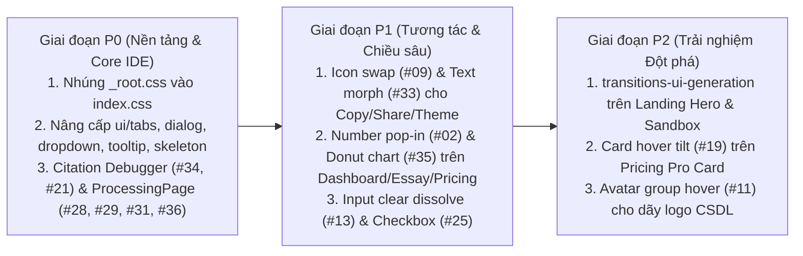

# Phân tích UI/UX Hiện tại & Đề xuất Tích hợp Trực tiếp Bộ `transitions.dev` cho CITRA (SourceLogic v2.0)

> **Tài liệu Kiến trúc Motion & UI/UX**  
> **Dự án:** CITRA — Academic Source Verification Workspace (`essay-integrity-checker/web`)  
> **Hệ thống Thiết kế hiện tại:** SourceLogic v2.0 + Solva Warm Editorial (`#FBFAF6` / `#1C1A15`, Sentient Serif + Onest/Inter Sans + JetBrains Mono)  
> **Bộ Skill áp dụng:** `transitions-dev` (36 CSS Transitions + Motion Tokens), `transitions-polish` (5 chiều tinh chỉnh & quy tắc bất đối xứng), `transitions-ui-generation` (5 biến thể hiệu ứng AI dựng giao diện trực tiếp)

---

## Mục lục

1. [Phần 1: Phân tích & Kiểm toán UI/UX Hiện tại (`transitions review` Audit)](#phần-1-phân-tích--kiểm-toán-uiux-hiện-tại-transitions-review-audit)
2. [Phần 2: Nền tảng Motion Tokens — Quy đổi `web/src/index.css` sang `_root.css`](#phần-2-nền-tảng-motion-tokens--quy-đổi-websrcindexcss-sang-_rootcss)
3. [Phần 3: Bảng Ánh xạ Tổng thể 36 Transitions & UI Generation vào CITRA](#phần-3-bảng-ánh-xạ-tổng-thể-36-transitions--ui-generation-vào-citra)
4. [Phần 4: Đề xuất Áp dụng Chi tiết vào Từng Khu vực & Từng File Code](#phần-4-đề-xuất-áp-dụng-chi-tiết-vào-từng-khu-vực--từng-file-code)
   - [4.1. Hệ thống Base UI Primitives (`web/src/components/ui/*`)](#41-hệ-thống-base-ui-primitives-websrcccomponentsui)
   - [4.2. App Shell, Sidebar, Theme & Notification Engine (`AppLayout`, `ThemeContext`, `ToastContext`)](#42-app-shell-sidebar-theme--notification-engine-applayout-themecontext-toastcontext)
   - [4.3. Landing Page & Pricing Page (`LandingPage.tsx`, `PricingPage.tsx`)](#43-landing-page--pricing-page-landingpagetsx-pricingpagetsx)
   - [4.4. Trang Tổng quan & Lịch sử (`DashboardPage.tsx`, `HistoryPage.tsx`, `StatCard.tsx`)](#44-trang-tổng-quan--lịch-sử-dashboardpagetsx-historypagetsx-statcardtsx)
   - [4.5. Trang Tải lên Đơn & Hàng loạt (`UploadPage.tsx`, `BatchUploadPage.tsx`)](#45-trang-tải-lên-đơn--hàng-loạt-uploadpagetsx-batchuploadpagetsx)
   - [4.6. Trang Tiến trình Kiểm chứng Thời gian thực (`ProcessingPage.tsx`)](#46-trang-tiến-trình-kiểm-chứng-thời-gian-thực-processingpagetsx)
   - [4.7. Trang Báo cáo & Citation Debugger IDE (`EssayPage.tsx` & các trang con)](#47-trang-báo-cáo--citation-debugger-ide-essaypagetsx--các-trang-con)
   - [4.8. Live Citation Sandbox (`LiveCitationSandbox.tsx`, `SandboxPage.tsx`)](#48-live-citation-sandbox-livecitationsandboxtsx-sandboxpagetsx)
   - [4.9. Trang Xác thực, Cài đặt & Quản trị (`LoginPage.tsx`, `SettingsPage.tsx`, Modals)](#49-trang-xác-thực-cài-đặt--quản-trị-loginpagetsx-settingspagetsx-modals)
5. [Phần 5: Lộ trình Triển khai Ưu tiên (P0 → P1 → P2) & Quy tắc Kỹ thuật Bắt buộc](#phần-5-lộ-trình-triển-khai-ưu-tiên-p0--p1--p2--quy-tắc-kỹ-thuật-bắt-buộc)

---

## Phần 1: Phân tích & Kiểm toán UI/UX Hiện tại (`transitions review` Audit)

Qua quá trình rà soát toàn bộ mã nguồn giao diện tại [`web/src/index.css`](file:///Users/iannwendy/Desktop/DATN/essay-integrity-checker/web/src/index.css), [`web/design-system/sourcelogic/MASTER.md`](file:///Users/iannwendy/Desktop/DATN/essay-integrity-checker/web/design-system/sourcelogic/MASTER.md) và hơn 35 trang/component trong `web/src/`, giao diện CITRA hiện tại có nền tảng thị giác rất tốt nhưng đang tồn tại **7 điểm nghẽn về chuyển động (Motion UX Bottlenecks)** mà bộ `transitions.dev` giải quyết trực tiếp:

### 1.1. Điểm mạnh hiện có cần giữ nguyên
- **Bảng màu & Typography học thuật (Solva Warm Editorial + SourceLogic v2.0):** Nền kem ấm `#FBFAF6` / mực `#1C1A15`, font serif `Sentient` kết hợp `Onest`/`Inter` và `JetBrains Mono` tạo cảm giác chuẩn mực như công cụ kiểm toán học thuật (Turnitin / Stripe / Linear).
- **Cơ chế vuốt đóng Toast 120fps:** Trong [`ToastContext.tsx`](file:///Users/iannwendy/Desktop/DATN/essay-integrity-checker/web/src/contexts/ToastContext.tsx#L774-L887), việc dùng `useRef` + ghi trực tiếp `el.style.transform` khi kéo con trỏ đã tránh được React re-render — rất đúng triết lý GPU compositor.
- **Tôn trọng Accessibility (`prefers-reduced-motion`):** Cuối file [`web/src/index.css`](file:///Users/iannwendy/Desktop/DATN/essay-integrity-checker/web/src/index.css#L1486-L1501) đã có media query tắt chuyển động cho người dùng nhạy cảm.

### 1.2. 7 Điểm nghẽn UI/UX & Motion cần nâng cấp bằng `transitions-dev`

| # | Điểm nghẽn hiện tại trong Codebase | Vị trí xuất hiện tiêu biểu | Hậu quả UX | Giải pháp từ `transitions.dev` |
|---|---|---|---|---|
| **1** | **Lạm dụng `transition-all duration-200` và thiếu hệ thống Token 5 chiều** | Hơn 60 vị trí trong [`tabs.tsx`](file:///Users/iannwendy/Desktop/DATN/essay-integrity-checker/web/src/components/ui/tabs.tsx#L83), [`UploadPage.tsx`](file:///Users/iannwendy/Desktop/DATN/essay-integrity-checker/web/src/pages/UploadPage.tsx#L590), [`EssayPage.tsx`](file:///Users/iannwendy/Desktop/DATN/essay-integrity-checker/web/src/pages/EssayPage.tsx#L2127), [`PricingPage.tsx`](file:///Users/iannwendy/Desktop/DATN/essay-integrity-checker/web/src/pages/PricingPage.tsx#L469) | `transition: all` vô tình animate cả `padding`, `border-width`, `box-shadow`, gây giật layout và thiếu chiều sâu (`--blur-*`, `--scale-*`, `--distance-*`). | Cài đặt [`_root.css`](file:///Users/iannwendy/.gemini/config/skills/transitions-dev/references/transitions/_root.css) + chuẩn hóa theo `transitions-polish` (chỉ animate `transform`, `opacity`, `filter`, `clip-path`). |
| **2** | **Thiếu tính bất đối xứng Đóng/Mở (Symmetric Open/Close & Instant Unmount)** | [`dialog.tsx`](file:///Users/iannwendy/Desktop/DATN/essay-integrity-checker/web/src/components/ui/dialog.tsx#L39-L55), [`BibliographyRemediationModal.tsx`](file:///Users/iannwendy/Desktop/DATN/essay-integrity-checker/web/src/components/BibliographyRemediationModal.tsx#L85), [`dropdown-menu.tsx`](file:///Users/iannwendy/Desktop/DATN/essay-integrity-checker/web/src/components/ui/dropdown-menu.tsx#L121), [`sheet.tsx`](file:///Users/iannwendy/Desktop/DATN/essay-integrity-checker/web/src/components/ui/sheet.tsx#L36) | Khi mở có `animate-scale-in`, nhưng khi đóng thì `if (!open) return null` làm modal/menu **biến mất đột ngột (0ms)** hoặc đóng chậm ngang lúc mở. | Áp dụng quy tắc **Open/Close Asymmetry** (`transitions-polish`): Mở có chủ đích (`250ms`–`400ms`), Đóng dứt khoát nhanh hơn 1–2 bậc (`150ms`–`350ms`). |
| **3** | **Tabs & Segmented Controls nhảy màu tức thời, không có viên thuốc trượt (Sliding Pill)** | [`tabs.tsx`](file:///Users/iannwendy/Desktop/DATN/essay-integrity-checker/web/src/components/ui/tabs.tsx#L49-L90), bộ chuyển chế độ xem trong [`EssayPage.tsx`](file:///Users/iannwendy/Desktop/DATN/essay-integrity-checker/web/src/pages/EssayPage.tsx#L2115-L2164), [`LiveCitationSandbox.tsx`](file:///Users/iannwendy/Desktop/DATN/essay-integrity-checker/web/src/components/LiveCitationSandbox.tsx#L429-L470), [`PricingPage.tsx`](file:///Users/iannwendy/Desktop/DATN/essay-integrity-checker/web/src/pages/PricingPage.tsx#L459-L497) | Khi bấm chuyển tab (`Inspector` ↔ `Overview`, `Monthly` ↔ `Annual`, `Manual` ↔ `Raw Line`), nền trắng chỉ bật/tắt tại chỗ, mất tính liên kết không gian. | Áp dụng **#16 Tabs sliding (`.t-tabs`)** với `::before` indicator dùng `--pill-left` và `--pill-width` trượt mượt trong `250ms`. |
| **4** | **Dữ liệu đổi tại chỗ (In-place Data Swap) bị giật cục trong Citation Debugger & Polling** | Khi click chọn trích dẫn `[1]`, `[2]` ở cột trái [`EssayPage.tsx`](file:///Users/iannwendy/Desktop/DATN/essay-integrity-checker/web/src/pages/EssayPage.tsx#L2301-L2690) hoặc khi [`ProcessingPage.tsx`](file:///Users/iannwendy/Desktop/DATN/essay-integrity-checker/web/src/pages/ProcessingPage.tsx#L448-L528) poll mỗi `800ms` | Toàn bộ bảng Metadata Diff, điểm tin cậy (Confidence %), câu giải thích AI và 4 bộ đếm nhảy số/chữ đột ngột không có cross-blur. | Kết hợp **#34 Text swap soft**, **#36 Number subtle change**, **#28 Thinking states**, **#29 Reasoning stream**, và **#30 Streaming text**. |
| **5** | **Tooltip hiện ngay lập tức (0ms delay) gây nhấp nháy khi lướt chuột** | [`tooltip.tsx`](file:///Users/iannwendy/Desktop/DATN/essay-integrity-checker/web/src/components/ui/tooltip.tsx#L27-L44) dùng trên thanh công cụ [`EssayHeader.tsx`](file:///Users/iannwendy/Desktop/DATN/essay-integrity-checker/web/src/pages/essay/EssayHeader.tsx#L243-L320) | Khi người dùng lia chuột qua dãy nút `Share`, `Auto-Fix`, `JSON`, `CSV`, `PDF`, `DOCX`, 6 tooltip bật tắt liên hoàn gây rối mắt. | Áp dụng **#17 Tooltip open/close (`.t-tt`)** có **Intent Delay `80ms`** (`--duration-micro`) khi vào đầu tiên, và trượt ngang (`translateX`) khi di chuyển giữa các nút cạnh nhau. |
| **6** | **Accordion & Khu vực thu/mở (Revision Tracker, FAQ) bật/tắt cứng bằng Conditional Render** | `{revisionExpanded && (...)}` trong [`EssayPage.tsx`](file:///Users/iannwendy/Desktop/DATN/essay-integrity-checker/web/src/pages/EssayPage.tsx#L1946) và FAQ trong [`LandingPage.tsx`](file:///Users/iannwendy/Desktop/DATN/essay-integrity-checker/web/src/pages/LandingPage.tsx) | Chiều cao nhảy từ `0` lên `400px` trong 1 frame làm toàn bộ trang bên dưới bị đẩy giật xuống. | Áp dụng **#21 Accordion expand (`.t-acc`)** dùng `grid-template-rows: 0fr → 1fr` + cross-blur + **#01 Card resize**. |
| **7** | **Skeleton Loader biến mất đột ngột khi dữ liệu tải xong** | [`PageSkeleton.tsx`](file:///Users/iannwendy/Desktop/DATN/essay-integrity-checker/web/src/components/PageSkeleton.tsx#L1-L97), [`DashboardPage.tsx`](file:///Users/iannwendy/Desktop/DATN/essay-integrity-checker/web/src/pages/DashboardPage.tsx#L273-L279), [`BibliographyRemediationModal.tsx`](file:///Users/iannwendy/Desktop/DATN/essay-integrity-checker/web/src/components/BibliographyRemediationModal.tsx#L280) | Đang nhấp nháy skeleton thì cắt bụp sang bảng dữ liệu thật, gây chói mắt. | Áp dụng **#14 Skeleton loader and reveal (`.t-skel`)** hòa tan skeleton sang nội dung thật qua `400ms` cross-fade + `--blur-small` (`2px`). |

---

## Phần 2: Nền tảng Motion Tokens — Quy đổi `web/src/index.css` sang `_root.css`

Hiện tại [`web/src/index.css`](file:///Users/iannwendy/Desktop/DATN/essay-integrity-checker/web/src/index.css#L72-L81) chỉ có 3 biến thời gian cơ bản (`--transition-fast`, `--transition-base`, `--transition-slow`) dùng chung một đường cong `cubic-bezier(0.4, 0, 0.2, 1)`.

**Đề xuất:** Nhúng toàn bộ khối `:root` từ [`_root.css`](file:///Users/iannwendy/.gemini/config/skills/transitions-dev/references/transitions/_root.css) của `transitions-dev` vào [`web/src/index.css`](file:///Users/iannwendy/Desktop/DATN/essay-integrity-checker/web/src/index.css#L72) và ánh xạ lại các biến cũ để tương thích ngược 100%:

```css
/* Trong web/src/index.css */
:root {
  /* 1. Durations (Thang thời gian chuẩn transitions.dev) */
  --duration-micro: 80ms;     /* Intent delay cho Tooltip / Hover */
  --duration-quick: 150ms;    /* Micro-interactions: đóng Modal/Dropdown, hover-in */
  --duration-fast: 250ms;     /* Mở Modal/Dropdown, trượt Tab pill, đổi Icon, xóa Input */
  --duration-moderate: 350ms; /* Đóng Panel/Toast, thu gọn Accordion */
  --duration-norm: 400ms;     /* Mở Panel/Toast/Accordion, Skeleton reveal, Card resize */
  --duration-slow: 600ms;     /* Chuyển trang lớn, Staggered text reveal */

  /* 2. Easings (Đường cong vật lý) */
  --ease-smooth-out: cubic-bezier(0.25, 1, 0.5, 1);        /* Đường cong mặc định cho mọi UI */
  --ease-overshoot: cubic-bezier(0.34, 1.56, 0.64, 1);     /* Nảy nhẹ có kiểm soát */
  --ease-bounce: linear(0, 0.009, 0.035 2.1%, 0.141, 0.281 6.7%, 0.723 12.9%, 0.938 16.7%, 1.017, 1.077, 1.121, 1.149 24.3%, 1.159, 1.163, 1.161, 1.154 29.9%, 1.129 32.8%, 1.051 39.6%, 1.017 43.1%, 0.991, 0.977 51%, 0.974 53.8%, 0.975 57.1%, 0.997 69.8%, 1.003 76.9%, 1.004 83.8%, 1);
  --ease-double-bounce: linear(0, 0.574 6.1%, 0.957 12.7%, 1.122 19.8%, 1.119 23.9%, 1.045 30.3%, 0.985 37.7%, 0.982 44.3%, 1 58.9%, 1);

  /* 3. Distances (Khoảng cách dịch chuyển) */
  --distance-micro: 2px;
  --distance-small: 4px;
  --distance-norm: 8px;
  --distance-large: 14px;
  --distance-xl: 24px;

  /* 4. Scales (Tỉ lệ thu phóng tinh tế - tránh zoom thô) */
  --scale-subtle: 0.98;
  --scale-small: 0.92;
  --scale-norm: 0.95;
  --scale-large: 0.96;
  --scale-xl: 0.85;

  /* 5. Blurs (Độ nhòe quang học khi cross-fade) */
  --blur-micro: 1px;
  --blur-small: 2px;
  --blur-norm: 4px;
  --blur-large: 8px;

  /* Tương thích ngược với các biến hiện có của CITRA */
  --transition-fast: var(--duration-quick) var(--ease-smooth-out);
  --transition-base: var(--duration-fast) var(--ease-smooth-out);
  --transition-slow: var(--duration-norm) var(--ease-smooth-out);
}
```

---

## Phần 3: Bảng Ánh xạ Tổng thể 36 Transitions & UI Generation vào CITRA

Dưới đây là bảng tra cứu nhanh cách ứng dụng **toàn bộ hệ sinh thái `transitions.dev`** vào từng thành phần của CITRA:

| Mã Recipe | Tên hiệu ứng (`transitions-dev`) | Class gốc | Áp dụng trực tiếp tại đâu trong CITRA (`web/src/`) | Mức ưu tiên |
|---|---|---|---|---|
| **#01** | [Card resize](file:///Users/iannwendy/.gemini/config/skills/transitions-dev/references/transitions/01-card-resize.md) | `.t-card` | Dropzone khi chọn file ([`UploadPage.tsx`](file:///Users/iannwendy/Desktop/DATN/essay-integrity-checker/web/src/pages/UploadPage.tsx#L588)), khung kết quả [`LiveCitationSandbox.tsx`](file:///Users/iannwendy/Desktop/DATN/essay-integrity-checker/web/src/components/LiveCitationSandbox.tsx#L760), khung Revision Tracker ([`EssayPage.tsx`](file:///Users/iannwendy/Desktop/DATN/essay-integrity-checker/web/src/pages/EssayPage.tsx#L1883)) | **P0** |
| **#02** | [Number pop-in](file:///Users/iannwendy/.gemini/config/skills/transitions-dev/references/transitions/02-number-pop-in.md) | `.t-num` | 4 thẻ thống kê [`DashboardPage.tsx`](file:///Users/iannwendy/Desktop/DATN/essay-integrity-checker/web/src/pages/DashboardPage.tsx#L221-L256), giá tiền khi đổi Monthly/Annual trong [`PricingPage.tsx`](file:///Users/iannwendy/Desktop/DATN/essay-integrity-checker/web/src/pages/PricingPage.tsx#L590), điểm CIS Score tổng | **P0** |
| **#03** | [Notification badge](file:///Users/iannwendy/.gemini/config/skills/transitions-dev/references/transitions/03-notification-badge.md) | `.t-badge` | Chấm số thông báo chưa đọc trên chuông [`ToastContext.tsx`](file:///Users/iannwendy/Desktop/DATN/essay-integrity-checker/web/src/contexts/ToastContext.tsx#L1234), badge tiến trình trên Sidebar [`AppLayout.tsx`](file:///Users/iannwendy/Desktop/DATN/essay-integrity-checker/web/src/components/AppLayout.tsx#L360) | **P1** |
| **#04** | [Text states swap](file:///Users/iannwendy/.gemini/config/skills/transitions-dev/references/transitions/04-text-states-swap.md) | `.t-swap` | Nút hành động đa trạng thái: `Start Verification` → `Uploading...` → `Analyzing...` ([`UploadPage.tsx`](file:///Users/iannwendy/Desktop/DATN/essay-integrity-checker/web/src/pages/UploadPage.tsx#L738)), nút `Auto-Healed .DOCX` ([`BibliographyRemediationModal.tsx`](file:///Users/iannwendy/Desktop/DATN/essay-integrity-checker/web/src/components/BibliographyRemediationModal.tsx#L255)) | **P0** |
| **#05** | [Menu dropdown](file:///Users/iannwendy/.gemini/config/skills/transitions-dev/references/transitions/05-menu-dropdown.md) | `.t-dropdown` | [`dropdown-menu.tsx`](file:///Users/iannwendy/Desktop/DATN/essay-integrity-checker/web/src/components/ui/dropdown-menu.tsx#L121), popover trung tâm thông báo [`ToastContext.tsx`](file:///Users/iannwendy/Desktop/DATN/essay-integrity-checker/web/src/contexts/ToastContext.tsx#L1255), menu chọn Revision ([`EssayPage.tsx`](file:///Users/iannwendy/Desktop/DATN/essay-integrity-checker/web/src/pages/EssayPage.tsx#L1902)) | **P0** |
| **#06** | [Modal open / close](file:///Users/iannwendy/.gemini/config/skills/transitions-dev/references/transitions/06-modal.md) | `.t-modal` | [`dialog.tsx`](file:///Users/iannwendy/Desktop/DATN/essay-integrity-checker/web/src/components/ui/dialog.tsx#L39), [`BibliographyRemediationModal.tsx`](file:///Users/iannwendy/Desktop/DATN/essay-integrity-checker/web/src/components/BibliographyRemediationModal.tsx#L160), [`UpgradeModal.tsx`](file:///Users/iannwendy/Desktop/DATN/essay-integrity-checker/web/src/components/UpgradeModal.tsx), [`ConfirmationModal.tsx`](file:///Users/iannwendy/Desktop/DATN/essay-integrity-checker/web/src/components/ConfirmationModal.tsx), [`HelpModal.tsx`](file:///Users/iannwendy/Desktop/DATN/essay-integrity-checker/web/src/components/HelpModal.tsx) | **P0** |
| **#07** | [Panel reveal](file:///Users/iannwendy/.gemini/config/skills/transitions-dev/references/transitions/07-panel-reveal.md) | `.t-panel` | [`sheet.tsx`](file:///Users/iannwendy/Desktop/DATN/essay-integrity-checker/web/src/components/ui/sheet.tsx#L36), Sidebar mobile trong [`AppLayout.tsx`](file:///Users/iannwendy/Desktop/DATN/essay-integrity-checker/web/src/components/AppLayout.tsx#L272), cột phải Inspector trong [`EssayPage.tsx`](file:///Users/iannwendy/Desktop/DATN/essay-integrity-checker/web/src/pages/EssayPage.tsx#L2421) | **P1** |
| **#08** | [Page transition](file:///Users/iannwendy/.gemini/config/skills/transitions-dev/references/transitions/08-page-transition.md) | `.t-page` | Chuyển đổi giữa các chế độ xem báo cáo (`Inspector` ↔ `Overview` ↔ `Split` trong [`EssayPage.tsx`](file:///Users/iannwendy/Desktop/DATN/essay-integrity-checker/web/src/pages/EssayPage.tsx#L2115)) và chuyển bước Onboarding | **P1** |
| **#09** | [Icon swap](file:///Users/iannwendy/.gemini/config/skills/transitions-dev/references/transitions/09-icon-swap.md) | `.t-icon-swap` | Nút đổi giao diện Sáng/Tối/Hệ thống ([`ThemeContext.tsx`](file:///Users/iannwendy/Desktop/DATN/essay-integrity-checker/web/src/contexts/ThemeContext.tsx#L149)), nút `Copy` ↔ `Check` trong [`BibliographyRemediationModal.tsx`](file:///Users/iannwendy/Desktop/DATN/essay-integrity-checker/web/src/components/BibliographyRemediationModal.tsx#L412) & [`LiveCitationSandbox.tsx`](file:///Users/iannwendy/Desktop/DATN/essay-integrity-checker/web/src/components/LiveCitationSandbox.tsx#L57), nút Ẩn/Hiện mật khẩu ([`LoginPage.tsx`](file:///Users/iannwendy/Desktop/DATN/essay-integrity-checker/web/src/pages/LoginPage.tsx#L315)) | **P0** |
| **#10** | [Success check](file:///Users/iannwendy/.gemini/config/skills/transitions-dev/references/transitions/10-success-check.md) | `.t-check` | Huy hiệu hoàn tất từng bước trong [`ProcessingPage.tsx`](file:///Users/iannwendy/Desktop/DATN/essay-integrity-checker/web/src/pages/ProcessingPage.tsx#L565), `ToastStatusGlyph` ([`ToastContext.tsx`](file:///Users/iannwendy/Desktop/DATN/essay-integrity-checker/web/src/contexts/ToastContext.tsx#L622)), huy hiệu `READY` khi chọn file ([`UploadPage.tsx`](file:///Users/iannwendy/Desktop/DATN/essay-integrity-checker/web/src/pages/UploadPage.tsx#L624)) | **P0** |
| **#11** | [Avatar group hover](file:///Users/iannwendy/.gemini/config/skills/transitions-dev/references/transitions/11-avatar-group-hover.md) | `.t-avatar` | Dãy icon định dạng file (`PDF`, `DOCX`, `BIB`, `RIS` trong [`UploadPage.tsx`](file:///Users/iannwendy/Desktop/DATN/essay-integrity-checker/web/src/pages/UploadPage.tsx#L656)), dãy logo 15+ CSDL học thuật (`Crossref`, `OpenAlex`, `Semantic Scholar`, `arXiv` trong [`LandingPage.tsx`](file:///Users/iannwendy/Desktop/DATN/essay-integrity-checker/web/src/pages/LandingPage.tsx)) | **P2** |
| **#12** | [Error state shake](file:///Users/iannwendy/.gemini/config/skills/transitions-dev/references/transitions/12-error-state-shake.md) | `.t-error-shake` | Ô nhập mã lớp `CITRA-XXXX` sai định dạng ([`UploadPage.tsx`](file:///Users/iannwendy/Desktop/DATN/essay-integrity-checker/web/src/pages/UploadPage.tsx#L690)), đăng nhập sai mật khẩu ([`LoginPage.tsx`](file:///Users/iannwendy/Desktop/DATN/essay-integrity-checker/web/src/pages/LoginPage.tsx#L205)), xác nhận xóa tài khoản sai ([`SettingsPage.tsx`](file:///Users/iannwendy/Desktop/DATN/essay-integrity-checker/web/src/pages/SettingsPage.tsx#L101)) | **P0** |
| **#13** | [Input clear with dissolve](file:///Users/iannwendy/.gemini/config/skills/transitions-dev/references/transitions/13-input-clear-dissolve.md) | `.t-clear` | Ô tìm kiếm tài liệu trong [`DashboardPage.tsx`](file:///Users/iannwendy/Desktop/DATN/essay-integrity-checker/web/src/pages/DashboardPage.tsx#L289-L311), ô lọc trích dẫn trong [`EssayPage.tsx`](file:///Users/iannwendy/Desktop/DATN/essay-integrity-checker/web/src/pages/EssayPage.tsx#L2231-L2247) | **P1** |
| **#14** | [Skeleton loader & reveal](file:///Users/iannwendy/.gemini/config/skills/transitions-dev/references/transitions/14-skeleton-reveal.md) | `.t-skel` | [`PageSkeleton.tsx`](file:///Users/iannwendy/Desktop/DATN/essay-integrity-checker/web/src/components/PageSkeleton.tsx), bảng tài liệu [`DashboardPage.tsx`](file:///Users/iannwendy/Desktop/DATN/essay-integrity-checker/web/src/pages/DashboardPage.tsx#L273), danh sách sửa lỗi trong [`BibliographyRemediationModal.tsx`](file:///Users/iannwendy/Desktop/DATN/essay-integrity-checker/web/src/components/BibliographyRemediationModal.tsx#L280) | **P0** |
| **#15** | [Shimmer text](file:///Users/iannwendy/.gemini/config/skills/transitions-dev/references/transitions/15-shimmer-text.md) | `.t-shimmer` | Dòng chữ trạng thái đang xử lý trong [`ProcessingPage.tsx`](file:///Users/iannwendy/Desktop/DATN/essay-integrity-checker/web/src/pages/ProcessingPage.tsx#L329), nút `Instant Verify` khi đang truy vấn API trong [`LiveCitationSandbox.tsx`](file:///Users/iannwendy/Desktop/DATN/essay-integrity-checker/web/src/components/LiveCitationSandbox.tsx#L750) | **P1** |
| **#16** | [Tabs sliding](file:///Users/iannwendy/.gemini/config/skills/transitions-dev/references/transitions/16-tabs-sliding.md) | `.t-tabs` | [`tabs.tsx`](file:///Users/iannwendy/Desktop/DATN/essay-integrity-checker/web/src/components/ui/tabs.tsx), bộ chuyển chế độ xem [`EssayPage.tsx`](file:///Users/iannwendy/Desktop/DATN/essay-integrity-checker/web/src/pages/EssayPage.tsx#L2115), thanh chọn chuẩn trích dẫn `APA / IEEE / Harvard / BibTeX / RIS` trong [`BibliographyRemediationModal.tsx`](file:///Users/iannwendy/Desktop/DATN/essay-integrity-checker/web/src/components/BibliographyRemediationModal.tsx#L211), toggle `Monthly / Annual` trong [`PricingPage.tsx`](file:///Users/iannwendy/Desktop/DATN/essay-integrity-checker/web/src/pages/PricingPage.tsx#L459) | **P0** |
| **#17** | [Tooltip open / close](file:///Users/iannwendy/.gemini/config/skills/transitions-dev/references/transitions/17-tooltip.md) | `.t-tt` | [`tooltip.tsx`](file:///Users/iannwendy/Desktop/DATN/essay-integrity-checker/web/src/components/ui/tooltip.tsx) và cụm nút xuất báo cáo `JSON / CSV / PDF / DOCX` trong [`EssayHeader.tsx`](file:///Users/iannwendy/Desktop/DATN/essay-integrity-checker/web/src/pages/essay/EssayHeader.tsx#L243-L320) | **P0** |
| **#18** | [Texts reveal](file:///Users/iannwendy/.gemini/config/skills/transitions-dev/references/transitions/18-texts-reveal.md) | `.t-stagger` | Tiêu đề & mô tả Hero trong [`LandingPage.tsx`](file:///Users/iannwendy/Desktop/DATN/essay-integrity-checker/web/src/pages/LandingPage.tsx), Empty State trong [`DashboardPage.tsx`](file:///Users/iannwendy/Desktop/DATN/essay-integrity-checker/web/src/pages/DashboardPage.tsx#L323), tiêu đề [`LoginPage.tsx`](file:///Users/iannwendy/Desktop/DATN/essay-integrity-checker/web/src/pages/LoginPage.tsx#L168) | **P1** |
| **#19** | [Card hover tilt](file:///Users/iannwendy/.gemini/config/skills/transitions-dev/references/transitions/19-card-tilt.md) | `.t-tilt` | Thẻ gói cước **Pro** nổi bật trong [`PricingPage.tsx`](file:///Users/iannwendy/Desktop/DATN/essay-integrity-checker/web/src/pages/PricingPage.tsx#L546) và thẻ Bento Feature trên [`LandingPage.tsx`](file:///Users/iannwendy/Desktop/DATN/essay-integrity-checker/web/src/pages/LandingPage.tsx) | **P2** |
| **#20** | [Plus to menu](file:///Users/iannwendy/.gemini/config/skills/transitions-dev/references/transitions/20-plus-to-menu.md) | `.t-fab` | Nút `+Quick Action` ở góc hoặc trên thanh Mobile Action để mở nhanh: `Tải lên PDF`, `Tải lên Hàng loạt`, `Thử Sandbox` | **P2** |
| **#21** | [Accordion expand](file:///Users/iannwendy/.gemini/config/skills/transitions-dev/references/transitions/21-accordion.md) | `.t-acc` | Khung `Revision Progress Tracker (v1 → v2)` trong [`EssayPage.tsx`](file:///Users/iannwendy/Desktop/DATN/essay-integrity-checker/web/src/pages/EssayPage.tsx#L1883-L2070), mục Câu hỏi thường gặp (`SolvaFAQSection`) ở [`LandingPage.tsx`](file:///Users/iannwendy/Desktop/DATN/essay-integrity-checker/web/src/pages/LandingPage.tsx) & [`PricingPage.tsx`](file:///Users/iannwendy/Desktop/DATN/essay-integrity-checker/web/src/pages/PricingPage.tsx#L735) | **P0** |
| **#22** | [Toast open / close](file:///Users/iannwendy/.gemini/config/skills/transitions-dev/references/transitions/22-toast.md) | `.t-toast` | Nâng cấp hiệu ứng xuất hiện/đóng của `ToastItem` trong [`ToastContext.tsx`](file:///Users/iannwendy/Desktop/DATN/essay-integrity-checker/web/src/contexts/ToastContext.tsx#L912-L930) với cross-blur và đóng bất đối xứng `350ms` | **P1** |
| **#24** | [Learn more hover](file:///Users/iannwendy/.gemini/config/skills/transitions-dev/references/transitions/24-learn-more-hover.md) | `.t-learn` | Các liên kết điều hướng có mũi tên: `Manage classes →` ([`UploadPage.tsx`](file:///Users/iannwendy/Desktop/DATN/essay-integrity-checker/web/src/pages/UploadPage.tsx#L700)), `View paper on Crossref →` ([`EssayPage.tsx`](file:///Users/iannwendy/Desktop/DATN/essay-integrity-checker/web/src/pages/EssayPage.tsx#L2710)), CTA phụ trên [`LandingPage.tsx`](file:///Users/iannwendy/Desktop/DATN/essay-integrity-checker/web/src/pages/LandingPage.tsx) | **P1** |
| **#25** | [Checkbox check](file:///Users/iannwendy/.gemini/config/skills/transitions-dev/references/transitions/25-checkbox-check.md) | `.t-checkbox` | 2 checkbox cấu hình Layer-1 (`Cite in body text`, `Include in References`) trong [`LiveCitationSandbox.tsx`](file:///Users/iannwendy/Desktop/DATN/essay-integrity-checker/web/src/components/LiveCitationSandbox.tsx#L726-L755) và checkbox đồng ý điều khoản đăng ký | **P1** |
| **#26** | [Spinning counter](file:///Users/iannwendy/.gemini/config/skills/transitions-dev/references/transitions/26-spinning-counter.md) | `.t-counter` | Vòng điểm **CIS Integrity Score (0–100)** khi mở báo cáo [`EssayPage.tsx`](file:///Users/iannwendy/Desktop/DATN/essay-integrity-checker/web/src/pages/EssayPage.tsx#L2075) hoặc khi hoàn tất kiểm chứng | **P1** |
| **#27** | [Toggle](file:///Users/iannwendy/.gemini/config/skills/transitions-dev/references/transitions/27-toggle.md) | `.t-toggle` | [`switch.tsx`](file:///Users/iannwendy/Desktop/DATN/essay-integrity-checker/web/src/components/ui/switch.tsx) dùng cho bật/tắt thông báo trong [`SettingsPage.tsx`](file:///Users/iannwendy/Desktop/DATN/essay-integrity-checker/web/src/pages/SettingsPage.tsx#L650) | **P1** |
| **#28** | [Thinking states](file:///Users/iannwendy/.gemini/config/skills/transitions-dev/references/transitions/28-thinking-states.md) | `.t-thinking` | Dòng telemetry `> {status.message}` trong [`ProcessingPage.tsx`](file:///Users/iannwendy/Desktop/DATN/essay-integrity-checker/web/src/pages/ProcessingPage.tsx#L526) xoay vòng các trạng thái suy luận AI kèm shimmer | **P0** |
| **#29** | [Reasoning stream](file:///Users/iannwendy/.gemini/config/skills/transitions-dev/references/transitions/29-reasoning-stream.md) | `.t-reasoning` | Luồng 8 bước kiểm chứng trong [`ProcessingPage.tsx`](file:///Users/iannwendy/Desktop/DATN/essay-integrity-checker/web/src/pages/ProcessingPage.tsx#L533-L621) và trang [`LogicTracePage.tsx`](file:///Users/iannwendy/Desktop/DATN/essay-integrity-checker/web/src/pages/LogicTracePage.tsx) | **P0** |
| **#30** | [Streaming text](file:///Users/iannwendy/.gemini/config/skills/transitions-dev/references/transitions/30-streaming-text.md) | `.t-stream` | Khối giải thích `Neuro-Symbolic Verdict Explanation` ở cột phải [`EssayPage.tsx`](file:///Users/iannwendy/Desktop/DATN/essay-integrity-checker/web/src/pages/EssayPage.tsx#L2494) & [`DocumentInspectorPage.tsx`](file:///Users/iannwendy/Desktop/DATN/essay-integrity-checker/web/src/pages/DocumentInspectorPage.tsx) | **P1** |
| **#31** | [Matrix dot loader](file:///Users/iannwendy/.gemini/config/skills/transitions-dev/references/transitions/31-matrix-loader.md) | `.t-matrix` | Thay thế icon `Loader2` xoay tròn đơn điệu ở bước đang chạy trong [`ProcessingPage.tsx`](file:///Users/iannwendy/Desktop/DATN/essay-integrity-checker/web/src/pages/ProcessingPage.tsx#L569) & [`BatchUploadPage.tsx`](file:///Users/iannwendy/Desktop/DATN/essay-integrity-checker/web/src/pages/BatchUploadPage.tsx#L62) bằng lưới chấm 5×5 kiểu học thuật/terminal | **P0** |
| **#32** | [Banner stacking](file:///Users/iannwendy/.gemini/config/skills/transitions-dev/references/transitions/32-banner-stacking.md) | `.t-banner-stack` | Gom gọn chồng thông báo hệ thống (Email chưa kích hoạt + Quota sắp hết + Tiến trình chạy nền) ở đầu trang [`UploadPage.tsx`](file:///Users/iannwendy/Desktop/DATN/essay-integrity-checker/web/src/pages/UploadPage.tsx#L253-L366) và [`ToastContainer`](file:///Users/iannwendy/Desktop/DATN/essay-integrity-checker/web/src/contexts/ToastContext.tsx#L1125) | **P1** |
| **#33** | [Text morph](file:///Users/iannwendy/.gemini/config/skills/transitions-dev/references/transitions/33-text-morph.md) | `.t-morph` | Nút `Copy` → `Copied`, `Share` → `Shared` ([`EssayHeader.tsx`](file:///Users/iannwendy/Desktop/DATN/essay-integrity-checker/web/src/pages/essay/EssayHeader.tsx#L225)), `Fill Demo` → `Filled` ([`LoginPage.tsx`](file:///Users/iannwendy/Desktop/DATN/essay-integrity-checker/web/src/pages/LoginPage.tsx#L63)) giữ nguyên các chữ cái chung (`Cop` / `Share`) | **P1** |
| **#34** | [Text swap soft](file:///Users/iannwendy/.gemini/config/skills/transitions-dev/references/transitions/34-text-swap-soft.md) | `.t-swap-soft` | Các ô giá trị trong bảng **Metadata Diff Table** (`Title`, `Authors`, `Year`, `Venue`, `DOI`) ở cột phải [`EssayPage.tsx`](file:///Users/iannwendy/Desktop/DATN/essay-integrity-checker/web/src/pages/EssayPage.tsx#L2652) khi người dùng click đổi giữa các trích dẫn `[1]`, `[2]`, `[3]` | **P0** |
| **#35** | [Donut chart](file:///Users/iannwendy/.gemini/config/skills/transitions-dev/references/transitions/35-donut-chart.md) | `.t-donut` | Biểu đồ tỉ lệ 4 loại phán quyết (`Verified`, `Metadata Error`, `Hallucinated`, `Unresolved`) trên [`EssayPage.tsx`](file:///Users/iannwendy/Desktop/DATN/essay-integrity-checker/web/src/pages/EssayPage.tsx#L2075) và khi đổi Revision `v1 ↔ v2` | **P1** |
| **#36** | [Number subtle change](file:///Users/iannwendy/.gemini/config/skills/transitions-dev/references/transitions/36-number-subtle-change.md) | `.t-num-subtle` | 4 số liệu telemetry cập nhật liên tục mỗi `800ms` (`Citations Found`, `References`, `Linked`, `To Verify`, `% Progress`) trong [`ProcessingPage.tsx`](file:///Users/iannwendy/Desktop/DATN/essay-integrity-checker/web/src/pages/ProcessingPage.tsx#L448-L516) | **P0** |
| **UI-Gen** | [`transitions-ui-generation`](file:///Users/iannwendy/.gemini/config/skills/transitions-ui-generation/SKILL.md) | `uiGeneration.play()` | **1.** `HeroVerificationMockup` trên [`LandingPage.tsx`](file:///Users/iannwendy/Desktop/DATN/essay-integrity-checker/web/src/pages/LandingPage.tsx) (`variant: "ui"`, `mode: "skeleton-texts"`)<br>**2.** Khung kết quả `Instant Verify` trong [`LiveCitationSandbox.tsx`](file:///Users/iannwendy/Desktop/DATN/essay-integrity-checker/web/src/components/LiveCitationSandbox.tsx) (`variant: "ui"`, `mode: "skeleton"`) | **P1** |

---

## Phần 4: Đề xuất Áp dụng Chi tiết vào Từng Khu vực & Từng File Code

### 4.1. Hệ thống Base UI Primitives (`web/src/components/ui/*`)

Việc nâng cấp 7 file gốc trong `web/src/components/ui/` sẽ **tự động nâng cấp trải nghiệm trên toàn bộ hơn 25 màn hình** của CITRA mà không cần sửa lặp lại ở từng trang.

#### A. [`web/src/components/ui/tabs.tsx`](file:///Users/iannwendy/Desktop/DATN/essay-integrity-checker/web/src/components/ui/tabs.tsx#L49-L90) — Áp dụng **#16 Tabs sliding (`.t-tabs`)**
- **Hiện trạng:** `TabsTrigger` (dòng 77–89) đang dùng `transition-all` để bật nền `bg-white text-slate-950 shadow-sm` ngay tại tab được chọn. Khi chuyển tab, viên nền trắng biến mất ở tab cũ và hiện ra ở tab mới mà không có chuyển động trượt ngang.
- **Đề xuất áp dụng `#16 Tabs sliding`:**
  - Trên `TabsList`, thêm `position: relative` và một pseudo-element `::before` đóng vai trò viên thuốc trượt (`--pill-left`, `--pill-width`).
  - Dùng `useLayoutEffect` + `ResizeObserver` đo `activeBtn.offsetLeft` và `activeBtn.offsetWidth` để cập nhật biến CSS `--pill-left` và `--pill-width`.
  - Lần đầu mount đặt `transition: none`, sau `requestAnimationFrame` thêm class `.is-ready` để bật `transition: transform var(--duration-fast) var(--ease-smooth-out), width var(--duration-fast) var(--ease-smooth-out)`.
- **Các nơi hưởng lợi ngay lập tức:**
  1. Tabs trong cột phải Citation Debugger (`Evidence` / `Metadata Diff` / `Context` tại [`EssayPage.tsx`](file:///Users/iannwendy/Desktop/DATN/essay-integrity-checker/web/src/pages/EssayPage.tsx#L2545)).
  2. Bộ chuyển đổi chế độ xem báo cáo (`Inspector` / `Overview` / `Split` tại [`EssayPage.tsx`](file:///Users/iannwendy/Desktop/DATN/essay-integrity-checker/web/src/pages/EssayPage.tsx#L2115-L2164)).
  3. Bộ chuyển đổi `Manual Fields` / `Raw Citation Line` trong [`LiveCitationSandbox.tsx`](file:///Users/iannwendy/Desktop/DATN/essay-integrity-checker/web/src/components/LiveCitationSandbox.tsx#L429-L470).
  4. Bộ chọn chuẩn trích dẫn `APA 7th` / `IEEE` / `Harvard` / `BibTeX` / `RIS` trong [`BibliographyRemediationModal.tsx`](file:///Users/iannwendy/Desktop/DATN/essay-integrity-checker/web/src/components/BibliographyRemediationModal.tsx#L211-L232).

#### B. [`web/src/components/ui/dialog.tsx`](file:///Users/iannwendy/Desktop/DATN/essay-integrity-checker/web/src/components/ui/dialog.tsx#L31-L78) — Áp dụng **#06 Modal open / close (`.t-modal`)**
- **Hiện trạng:** Dòng 39 dùng `if (!context.open) return null;` khiến khi bấm đóng, modal biến mất tức khắc (0ms). Khi mở thì dùng `animate-scale-in` đối xứng `200ms`.
- **Đề xuất áp dụng `#06 Modal open / close` + `transitions-polish`:**
  - Giữ DOM tồn tại hoặc điều khiển qua class `.is-open` với `visibility` + `pointer-events`.
  - **Khi Đóng (Base rule):** `transition: opacity var(--duration-quick) var(--ease-smooth-out), transform var(--duration-quick) var(--ease-smooth-out), visibility 0ms linear var(--duration-quick)` (`150ms`, thu nhẹ về `scale(var(--scale-large))` = `0.96`).
  - **Khi Mở (`.is-open` override):** `transition: opacity var(--duration-fast) var(--ease-smooth-out), transform var(--duration-fast) var(--ease-smooth-out), visibility 0ms` (`250ms`, phóng từ `0.96` → `1`).

#### C. [`web/src/components/ui/dropdown-menu.tsx`](file:///Users/iannwendy/Desktop/DATN/essay-integrity-checker/web/src/components/ui/dropdown-menu.tsx#L112-L137) — Áp dụng **#05 Menu dropdown (`.t-dropdown`)**
- **Hiện trạng:** `DropdownMenuContent` chỉ dùng `animate-fade-in` chung chung, không phóng ra từ góc của nút bấm (`transform-origin`).
- **Đề xuất áp dụng `#05 Menu dropdown`:**
  - Gắn `data-origin="top-right"` (hoặc `top-left` tùy `align="end" | "start"`).
  - Mở trong `250ms` (`--duration-fast`) từ `scale(var(--scale-norm))` (`0.95`) + `translateY(-4px)` + `blur(2px)`.
  - Đóng nhanh trong `150ms` (`--duration-quick`).

#### D. [`web/src/components/ui/tooltip.tsx`](file:///Users/iannwendy/Desktop/DATN/essay-integrity-checker/web/src/components/ui/tooltip.tsx#L18-L45) — Áp dụng **#17 Tooltip open / close (`.t-tt`)**
- **Hiện trạng:** Tooltip thuần CSS `opacity-0 group-hover:opacity-100 transition-opacity`, không có độ trễ chủ đích (intent delay) và không có hiệu ứng trượt ngang khi di chuột qua hàng nút sát nhau.
- **Đề xuất áp dụng `#17 Tooltip open / close`:**
  - Thêm **Intent Delay `80ms`** (`--duration-micro`) khi bắt đầu hover để lướt chuột ngang qua không làm nháy tooltip.
  - Khi người dùng di chuột từ nút xuất `JSON` sang `CSV`, `PDF`, `DOCX` trên [`EssayHeader.tsx`](file:///Users/iannwendy/Desktop/DATN/essay-integrity-checker/web/src/pages/essay/EssayHeader.tsx#L243-L320) trong vòng `< 250ms`, bỏ qua intent delay và cho hộp tooltip trượt ngang mượt mà (`transition: left var(--duration-quick) var(--ease-smooth-out)`).

#### E. [`web/src/components/ui/sheet.tsx`](file:///Users/iannwendy/Desktop/DATN/essay-integrity-checker/web/src/components/ui/sheet.tsx#L30-L85) — Áp dụng **#07 Panel reveal (`.t-panel`)**
- **Đề xuất:** Bổ sung cross-blur nhẹ (`filter: blur(var(--blur-small))`) và tách thời gian Mở `400ms` (`--duration-norm`) / Đóng `350ms` (`--duration-moderate`).

#### F. [`web/src/components/ui/switch.tsx`](file:///Users/iannwendy/Desktop/DATN/essay-integrity-checker/web/src/components/ui/switch.tsx#L1-L35) — Áp dụng **#27 Toggle (`.t-toggle`)**
- **Đề xuất:** Thay `transition-transform` mặc định của chấm tròn (`thumb`) bằng đường cong đàn hồi kép `var(--ease-double-bounce)` trong `350ms` (`--duration-moderate`), trong khi màu nền track chuyển mượt bằng `var(--ease-smooth-out)` trong `250ms`.

---

### 4.2. App Shell, Sidebar, Theme & Notification Engine (`AppLayout`, `ThemeContext`, `ToastContext`)

#### A. [`web/src/contexts/ThemeContext.tsx`](file:///Users/iannwendy/Desktop/DATN/essay-integrity-checker/web/src/contexts/ThemeContext.tsx#L149-L185) & [`web/src/components/AppLayout.tsx`](file:///Users/iannwendy/Desktop/DATN/essay-integrity-checker/web/src/components/AppLayout.tsx#L465-L490) — Áp dụng **#09 Icon swap (`.t-icon-swap`)**
- **Hiện trạng:** Nút `ThemeToggle` render điều kiện `{theme === 'dark' ? <Moon /> : <Sun />}` làm icon nhảy đột ngột khi bấm.
- **Đề xuất áp dụng `#09 Icon swap`:**
  - Đặt cả `<Sun />` và `<Moon />` chồng lên nhau trong `.t-icon-swap` (`display: inline-grid`).
  - Icon ẩn có `opacity: 0; transform: scale(var(--scale-xl)) rotate(-45deg); filter: blur(var(--blur-small))`.
  - Khi bấm đổi theme, hai icon hòa tan chéo (cross-dissolve + blur `2px`) trong `250ms`.

#### B. [`web/src/contexts/ToastContext.tsx`](file:///Users/iannwendy/Desktop/DATN/essay-integrity-checker/web/src/contexts/ToastContext.tsx#L622-L1290) — Áp dụng **#03 Notification badge**, **#10 Success check**, **#22 Toast**, **#32 Banner stacking**
- **Huy hiệu số lượng thông báo (`NotificationCenterButton`, dòng 1234):** Áp dụng **#03 Notification badge (`.t-badge`)** — khi có thông báo mới, huy hiệu trượt chéo từ `translate(-6px, 6px) scale(0.5)` lên góc chuông với lò xo `var(--ease-bounce)` trong `350ms`.
- **Biểu tượng trạng thái Toast (`ToastStatusGlyph`, dòng 622):** Hiện đang dùng `stroke-dasharray: 32` cố định. Nâng cấp theo đúng chuẩn **#10 Success check**: đo `path.getTotalLength()` thực tế khi mount để nét vẽ dấu tích luôn khớp 100% chiều dài SVG.
- **Xếp chồng nhiều Toast (`ToastContainer`, dòng 1125):** Kết hợp **#32 Banner stacking** khi có > 2 thông báo cùng lúc: các toast phía sau thu nhẹ theo công thức `scale(calc(1 - var(--i) * 0.04))` và chỉ xòe rộng toàn bộ khi người dùng rê chuột vào cụm thông báo.

---

### 4.3. Landing Page & Pricing Page (`LandingPage.tsx`, `PricingPage.tsx`)

#### A. [`web/src/pages/LandingPage.tsx`](file:///Users/iannwendy/Desktop/DATN/essay-integrity-checker/web/src/pages/LandingPage.tsx#L210-L420) — Kết hợp **`transitions-ui-generation`** + **#18 Texts reveal** + **#21 Accordion**
1. **Hiệu ứng AI dựng trực tiếp khung `HeroVerificationMockup` (`transitions-ui-generation`):**
   - **Đề xuất đột phá:** Khung mô phỏng kiểm chứng trích dẫn ở Hero (`HeroVerificationMockup`) là điểm nhấn quan trọng nhất của trang chủ. Khi trang vừa tải xong, gọi:
     ```ts
     uiGeneration.play(heroMockupRef.current, {
       variant: 'ui',
       mode: 'skeleton-texts',
     });
     ```
   - Người truy cập sẽ thấy một **bản vẽ khung dây chấm bi (dotted wireframe)** kèm đường quét laser và dòng trạng thái agent (`Extracting citations... → Cross-referencing Crossref & OpenAlex... → Rendering CIS Report`) tự động dựng nên giao diện kiểm chứng của CITRA ngay trước mắt.
2. **Tiêu đề Hero (`SolvaTwoToneHeading`):** Áp dụng **#18 Texts reveal (`.t-stagger`)** — tiêu đề lớn xuất hiện ở `t = 0ms`, phụ đề ở `t = 70ms`, và cụm nút CTA ở `t = 140ms` với `translateY(14px)` + `blur(4px) → 0`.
3. **Dãy logo 15+ CSDL Học thuật (`Crossref`, `OpenAlex`, `Semantic Scholar`, `PubMed`, `arXiv`, `HAL`, `DOAJ`):** Áp dụng **#11 Avatar group hover (`.t-avatar`)** — khi rê chuột vào một logo, logo đó nổi lên `-6px` (`scale(1.06)`) và 2 logo bên cạnh nổi nhẹ `-3px` tạo hiệu ứng sóng lan tỏa.
4. **Mục Câu hỏi thường gặp (`SolvaFAQSection`):** Áp dụng **#21 Accordion expand (`.t-acc`)** dùng `grid-template-rows: 0fr → 1fr` (mở `400ms`, đóng `350ms`) và lật mũi tên đối xứng qua `transform: scaleY(-1)`.

#### B. [`web/src/pages/PricingPage.tsx`](file:///Users/iannwendy/Desktop/DATN/essay-integrity-checker/web/src/pages/PricingPage.tsx#L459-L760) — Áp dụng **#16 Tabs sliding**, **#02 Number pop-in**, **#19 Card hover tilt**
1. **Thanh chuyển đổi chu kỳ thanh toán (`Monthly` ↔ `Annual -20%`, dòng 459–497):**
   - Áp dụng **#16 Tabs sliding (`.t-tabs`)** cho viên thuốc chọn chu kỳ.
   - Ngay khi bấm chuyển `Monthly` ↔ `Annual`, con số giá tiền của gói **Pro** (`$20` ↔ `$16`) và **Ultra** (`$200` ↔ `$160`) (dòng 590) áp dụng **#02 Number pop-in (`.t-num`)**: số cũ trượt lên và mờ đi (`translateY(-14px) blur(4px)`), số mới trượt từ dưới lên với nhịp nảy nhẹ `var(--ease-overshoot)`.
2. **Thẻ gói cước Pro nổi bật (dòng 546):**
   - Áp dụng **#19 Card hover tilt (`.t-tilt`)** với giới hạn nghiêng tinh tế (`MAX_TILT = 4deg`) và vệt sáng phản chiếu (`glare`) đi theo con trỏ chuột.

---

### 4.4. Trang Tổng quan & Lịch sử (`DashboardPage.tsx`, `HistoryPage.tsx`, `StatCard.tsx`)

#### A. [`web/src/pages/DashboardPage.tsx`](file:///Users/iannwendy/Desktop/DATN/essay-integrity-checker/web/src/pages/DashboardPage.tsx#L221-L361) & [`web/src/components/StatCard.tsx`](file:///Users/iannwendy/Desktop/DATN/essay-integrity-checker/web/src/components/StatCard.tsx)
1. **4 Thẻ chỉ số học thuật (`Total Documents`, `Citations Checked`, `Mean CIS Score`, `Verified Rate`, dòng 221–256):**
   - Áp dụng **#02 Number pop-in (`.t-num`)** khi dữ liệu thống kê tải xong hoặc khi người dùng xóa/thêm bài luận làm thay đổi chỉ số.
2. **Ô tìm kiếm bài luận (`searchQuery`, dòng 289–311):**
   - Hiện tại khi bấm nút `XCircle` (dòng 303), chuỗi tìm kiếm biến mất tức thì (`setSearchQuery('')`).
   - Áp dụng **#13 Input clear with dissolve (`.t-clear`)**: khi bấm nút xóa, chữ trong ô tìm kiếm trượt nhẹ sang phải `8px` kèm hiệu ứng nhòe `blur(2px)` và tan biến trong `250ms` trước khi input được làm trống.
3. **Chuyển từ Skeleton sang Danh sách bài luận (dòng 273–285):**
   - Áp dụng **#14 Skeleton loader and reveal (`.t-skel`)** để 3 dòng skeleton mờ dần kèm `blur(2px)` trong khi danh sách bài luận thật hiện rõ lên trong `400ms`.

---

### 4.5. Trang Tải lên Đơn & Hàng loạt (`UploadPage.tsx`, `BatchUploadPage.tsx`)

#### A. [`web/src/pages/UploadPage.tsx`](file:///Users/iannwendy/Desktop/DATN/essay-integrity-checker/web/src/pages/UploadPage.tsx#L588-L760)
1. **Khung Dropzone biến hình khi chọn tệp (dòng 588–676):**
   - Khi người dùng kéo thả tệp PDF/DOCX/BIB/RIS vào, khung Dropzone chuyển từ trạng thái hướng dẫn sang thẻ thông tin tệp đã chọn (`file.name`, dung lượng, nút `Change file`).
   - Bọc Dropzone bằng **#01 Card resize (`.t-card`)** (đo `scrollHeight` trước và sau để animate chiều cao mượt trong `400ms`) kết hợp **#10 Success check (`.t-check`)** vẽ dấu tích xanh bên trong huy hiệu `READY` (dòng 624).
2. **Dãy 4 biểu tượng định dạng (`PDF`, `DOCX`, `BIB`, `RIS`, dòng 656–664):**
   - Áp dụng **#11 Avatar group hover (`.t-avatar`)** để khi rê chuột vào xem định dạng hỗ trợ, các icon nâng lên theo đường cong khoảng cách.
3. **Ô nhập mã lớp học `CITRA-XXXX` & Thông báo lỗi tệp (dòng 679–720):**
   - Khi người dùng nhập sai định dạng mã lớp hoặc chọn tệp vượt quá dung lượng gói cước (`> 10MB`), áp dụng **#12 Error state shake (`.t-error-shake`)**: tách biệt `.is-error` (viền đỏ giữ nguyên) và `.is-shaking` (rung ngang tắt dần `±6px → ±4px → ±2px` trong `400ms` mỗi khi bấm Submit lại).
4. **Nút bấm chính `Verify Citations` (dòng 738):**
   - Áp dụng **#04 Text states swap (`.t-swap`)** để nhãn nút chuyển mượt giữa 3 trạng thái: `Verify Citations` → `Uploading Document...` → `Initializing Pipeline...`.

---

### 4.6. Trang Tiến trình Kiểm chứng Thời gian thực (`ProcessingPage.tsx`)

[`web/src/pages/ProcessingPage.tsx`](file:///Users/iannwendy/Desktop/DATN/essay-integrity-checker/web/src/pages/ProcessingPage.tsx#L315-L625) là nơi người dùng chờ hệ thống chạy qua 8 bước kiểm chứng. Đây là màn hình phù hợp nhất để kết hợp **bộ 5 hiệu ứng AI/Telemetry của `transitions-dev`**:

1. **Biểu tượng bước đang chạy (dòng 569):**
   - Thay thế `<Loader2 className="animate-spin" />` ở bước đang active bằng **#31 Matrix dot loader (`.t-matrix`)** (lưới chấm bi 5×5 chạy sóng chéo chuẩn phong cách phòng thí nghiệm dữ liệu).
2. **Khi mỗi bước hoàn tất (`status === 'completed'`, dòng 565):**
   - Thay vì đổi tĩnh sang `<CheckCircle2 />`, chạy **#10 Success check (`.t-check`)**: vòng tròn xanh nở ra (`250ms`) rồi nét vẽ dấu tích tự vạch sau `80ms` delay.
3. **Dòng nhật ký trạng thái trực tiếp `> {status.message}` (dòng 526):**
   - Áp dụng **#28 Thinking states (`.t-thinking`)** kết hợp **#15 Shimmer text (`.t-shimmer`)**: mỗi khi backend trả về câu thông báo mới (ví dụ: `"Đang trích xuất trích dẫn bằng GROBID..."` → `"Đang truy vấn chéo Crossref, OpenAlex, Semantic Scholar..."`), câu cũ trượt lên mờ đi và câu mới trượt vào kèm ánh sáng quét ngang chữ.
4. **Luồng 8 bước kiểm chứng (dòng 533–621):**
   - Áp dụng **#29 Reasoning stream (`.t-reasoning`)** để bước đang thực thi tự động mở rộng phần mô tả chi tiết bên dưới và thu gọn gọn gàng khi chuyển sang bước kế tiếp.
5. **4 Bộ đếm Telemetry thời gian thực (`Citations Found`, `References`, `Linked`, `To Verify` ở dòng 448–484 và `%` ở dòng 516):**
   - Do trang poll mỗi `800ms`, dùng `#02 Number pop-in` sẽ quá ồn. Thay vào đó, áp dụng đúng chỉ định của skill là **#36 Number subtle change (`.t-num-subtle`)**: các chữ số thay đổi sẽ hòa tan cực êm tại chỗ (`translateY(±2px)` + `blur(1px)` trong `150ms`), giữ nguyên các chữ số hàng chục/trăm không đổi.

---

### 4.7. Trang Báo cáo & Citation Debugger IDE (`EssayPage.tsx` & các trang con)

[`web/src/pages/EssayPage.tsx`](file:///Users/iannwendy/Desktop/DATN/essay-integrity-checker/web/src/pages/EssayPage.tsx) (cùng với [`EssayHeader.tsx`](file:///Users/iannwendy/Desktop/DATN/essay-integrity-checker/web/src/pages/essay/EssayHeader.tsx), [`EssayActionBar.tsx`](file:///Users/iannwendy/Desktop/DATN/essay-integrity-checker/web/src/pages/essay/EssayActionBar.tsx), [`BibliographyRemediationModal.tsx`](file:///Users/iannwendy/Desktop/DATN/essay-integrity-checker/web/src/components/BibliographyRemediationModal.tsx), [`DocumentInspectorPage.tsx`](file:///Users/iannwendy/Desktop/DATN/essay-integrity-checker/web/src/pages/DocumentInspectorPage.tsx)) là trái tim của sản phẩm CITRA:

1. **Tương tác Cột Trái → Cột Phải trong Split-Pane Citation Debugger ([`EssayPage.tsx`](file:///Users/iannwendy/Desktop/DATN/essay-integrity-checker/web/src/pages/EssayPage.tsx#L2301-L2690)):**
   - **Hiện trạng:** Khi người dùng click từ trích dẫn `[1]` sang `[2]` ở cột trái, toàn bộ dữ liệu ở cột phải (`Selected Citation Inspector`, dòng 2421) đổi tức thì gây mất phương hướng thị giác.
   - **Đề xuất:**
     - **Bảng đối chiếu Metadata (`Title`, `Authors`, `Year`, `Venue`, `DOI`, dòng 2652):** Áp dụng **#34 Text swap soft (`.t-swap-soft`)** — giá trị cũ và mới của từng hàng bảng cross-fade êm ái qua `blur(2px)` trong `250ms` mà không làm rung khung bảng.
     - **Khối giải thích `Neuro-Symbolic Verdict Explanation` (dòng 2494):** Áp dụng **#30 Streaming text (`.t-stream`)** — từng cụm từ phân tích lý do vì sao trích dẫn bị gắn cờ `Metadata Error` hoặc `Suspected Hallucination` hiện ra mượt mà như trợ lý học thuật đang trình bày.
     - **Điểm độ tin cậy (`Confidence %`):** Áp dụng **#36 Number subtle change (`.t-num-subtle`)**.
2. **Khung theo dõi tiến trình chỉnh sửa `Revision Progress Tracker (v1 → v2)` (dòng 1883–2070):**
   - Thay thế `{revisionExpanded && (...)}` bằng **#21 Accordion expand (`.t-acc`)** + **#01 Card resize (`.t-card`)** để bảng so sánh giữa các lần nộp bài mở/đóng mượt mà.
3. **Biểu đồ phân bổ Phán quyết & Điểm CIS Score (dòng 2075):**
   - Áp dụng **#35 Donut chart (`.t-donut`)** cho tỉ lệ 4 nhóm (`Verified` xanh ngọc, `Metadata Error` vàng hổ phách, `Hallucinated` đỏ, `Unresolved` xám) với đầu đoạn bo tròn và khe hở đều nhau; khi chuyển đổi giữa `v1` và `v2`, các cung tròn tự động co giãn tỉ lệ mượt mà.
   - Áp dụng **#26 Spinning counter (`.t-counter`)** cho điểm tổng **CIS Integrity Score (0–100)**.
4. **Thanh công cụ Header ([`EssayHeader.tsx`](file:///Users/iannwendy/Desktop/DATN/essay-integrity-checker/web/src/pages/essay/EssayHeader.tsx#L215-L320)):**
   - Nút `Share`: Áp dụng **#33 Text morph (`.t-morph`)** để chữ `"Share"` biến hình thành `"Shared"` (giữ nguyên 5 chữ cái `S-h-a-r-e`, chỉ thêm chữ `d` trượt vào) + **#09 Icon swap** đổi icon `Share2` → `Check`.
   - Dãy nút xuất file (`JSON`, `CSV`, `PDF`, `DOCX`): Áp dụng **#17 Tooltip open/close (`.t-tt`)** có intent delay `80ms` và trượt ngang liên hoàn.
5. **Studio Chuẩn hóa Danh mục Tài liệu Tham khảo ([`BibliographyRemediationModal.tsx`](file:///Users/iannwendy/Desktop/DATN/essay-integrity-checker/web/src/components/BibliographyRemediationModal.tsx)):**
   - Khung Modal: **#06 Modal open / close** (`250ms` mở / `150ms` đóng).
   - Thanh chọn chuẩn `APA 7th / IEEE / Harvard / BibTeX / RIS` (dòng 211): **#16 Tabs sliding (`.t-tabs`)**.
   - Nút `Copy` từng mục tài liệu (dòng 412) và `Copy All` (dòng 237): **#09 Icon swap** (`Copy` ↔ `Check`) + **#33 Text morph** (`Copy` ↔ `Copied`).
   - Khi chuyển đổi chuẩn trích dẫn (ví dụ từ `APA` sang `IEEE` hoặc `BibTeX`), danh sách chuỗi trích dẫn đã chuẩn hóa đổi nội dung qua **#14 Skeleton loader & reveal** hoặc **#34 Text swap soft**.

---

### 4.8. Live Citation Sandbox (`LiveCitationSandbox.tsx`, `SandboxPage.tsx`)

Trong [`web/src/components/LiveCitationSandbox.tsx`](file:///Users/iannwendy/Desktop/DATN/essay-integrity-checker/web/src/components/LiveCitationSandbox.tsx):
1. **Thanh chuyển chế độ nhập `Manual Fields` ↔ `Raw Citation Line` (dòng 429–470):** Áp dụng **#16 Tabs sliding (`.t-tabs`)**.
2. **Các nút kịch bản kiểm thử 1-Click (`Wrong Year`, `Wrong Author`, `Hallucinate Title`, dòng 608–667):**
   - Khi bấm vào một preset đột biến dữ liệu, các ô input (`Title`, `Author`, `Year`, `DOI`) được điền giá trị mới bằng hiệu ứng **#34 Text swap soft (`.t-swap-soft`)** để người dùng nhìn rõ trường nào vừa bị làm sai lệch.
3. **2 Checkbox cấu hình Layer-1 (`Cite in body text [1]`, `Include in References section`, dòng 726–755):**
   - Thay `<input type="checkbox">` mặc định của trình duyệt bằng **#25 Checkbox check (`.t-checkbox`)** với hiệu ứng lấp đầy nền (`150ms`) + vẽ nét dấu tích (`250ms`, delay `50ms`).
4. **Khung kết quả `Instant Verify` & `Generate Synthetic Test PDF` (dòng 760+):**
   - Áp dụng **#01 Card resize (`.t-card`)** kết hợp **`transitions-ui-generation`** (`variant: "ui"`, `mode: "skeleton"`) trong lần đầu trả kết quả kiểm chứng trực tiếp.

---

### 4.9. Trang Xác thực, Cài đặt & Quản trị (`LoginPage.tsx`, `SettingsPage.tsx`, Modals)

1. **[`web/src/pages/LoginPage.tsx`](file:///Users/iannwendy/Desktop/DATN/essay-integrity-checker/web/src/pages/LoginPage.tsx) & `RegisterPage.tsx`:**
   - Khi đăng nhập thất bại (`error !== ''`, dòng 205): Áp dụng **#12 Error state shake (`.t-error-shake`)** lên khung form và hiển thị hộp cảnh báo lỗi với cross-blur.
   - Nút ẩn/hiện mật khẩu (`Eye` ↔ `EyeOff`, dòng 315): Áp dụng **#09 Icon swap (`.t-icon-swap`)**.
   - Nút `Fill Demo Credentials` (dòng 63): Áp dụng **#33 Text morph (`.t-morph`)** + **#10 Success check**.
2. **[`web/src/pages/SettingsPage.tsx`](file:///Users/iannwendy/Desktop/DATN/essay-integrity-checker/web/src/pages/SettingsPage.tsx):**
   - Bộ chọn Giao diện `Light` / `Dark` / `System` và Ngôn ngữ `Tiếng Việt` / `English`: Áp dụng **#16 Tabs sliding (`.t-tabs`)**.
   - Công tắc bật/tắt thông báo (`Switch`): Áp dụng **#27 Toggle (`.t-toggle`)**.
   - Khi tạo khóa API cá nhân mới (`newlyCreatedKey`, dòng 188): Khung hiển thị `raw_key` mở rộng mượt bằng **#21 Accordion expand (`.t-acc`)**, và nút sao chép khóa dùng **#09 Icon swap** + **#33 Text morph**.
   - Modal xác nhận xóa tài khoản (dòng 90): Dùng **#06 Modal open / close** + **#12 Error state shake** khi nhập sai mật khẩu/username xác nhận.

---

## Phần 5: Lộ trình Triển khai Ưu tiên (P0 → P1 → P2) & Quy tắc Kỹ thuật Bắt buộc

### 5.1. Lộ trình 3 Giai đoạn



### 5.2. 6 Quy tắc Kỹ thuật Bắt buộc (Từ `transitions-dev` & `transitions-polish`)

> [!IMPORTANT]
> Khi bắt tay vào code các đề xuất trên, cần tuân thủ nghiêm ngặt 6 nguyên tắc sau để đạt chuẩn 120fps và không phá vỡ giao diện hiện tại:

1. **Tuyệt đối không dùng `transition: all`:** Luôn liệt kê chính xác thuộc tính cần chuyển động (`transform`, `opacity`, `filter`, `clip-path`, `background-color`).
2. **Bất đối xứng Đóng / Mở (Open/Close Asymmetry):**
   - Modal / Dropdown: Mở `250ms` (`--duration-fast`), Đóng `150ms` (`--duration-quick`).
   - Drawer / Sheet / Toast / Accordion: Mở `400ms` (`--duration-norm`), Đóng `350ms` (`--duration-moderate`).
   - Cách viết CSS: Đặt tốc độ **Đóng** ở rule cơ sở (`.t-modal`), và ghi đè tốc độ **Mở** ở rule `.is-open`.
3. **Bất đối xứng Hover Vào / Ra (Hover In/Out Asymmetry):**
   - Hover vào (Pointer Enter): `150ms` (`--duration-quick`) để phản hồi nhạy.
   - Hover ra (Pointer Leave): `250ms`–`350ms` (`--duration-fast` / `--duration-moderate`) để hạ cánh êm.
4. **Không gắn `filter: blur()` tĩnh khi phần tử đang đứng yên:** Chỉ gắn `filter: blur(...)` ở trạng thái đang chuyển tiếp hoặc ẩn (`opacity: 0`) để tránh tạo stacking context không cần thiết gây mờ chữ Retina.
5. **Đo `path.getTotalLength()` cho mọi SVG stroke animation (`#10`, `#25`):** Không hardcode `stroke-dasharray: 24` hay `32` vì kích thước icon ở mỗi nơi (`Toast`, `Upload`, `Processing`) khác nhau.
6. **Bảo toàn Accessibility (`prefers-reduced-motion: reduce`):** Mọi class `.t-*` và `uiGeneration.play()` phải tự động rút gọn về hiển thị tức thời khi người dùng bật chế độ giảm chuyển động của hệ điều hành.
